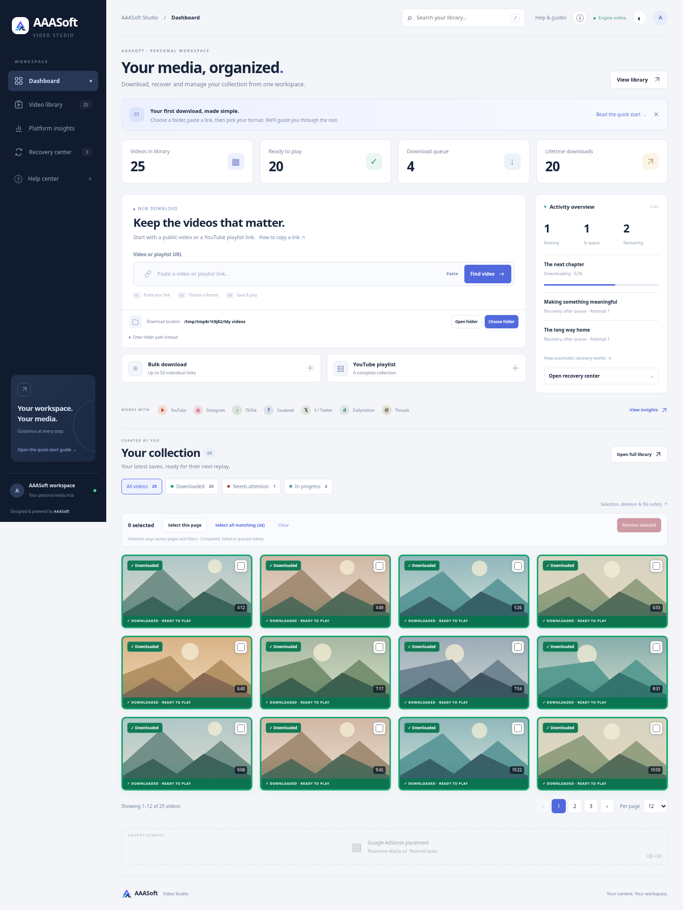

# AAASoft Video Studio

AAASoft-branded browser video downloader with a professional download workbench and live activity dashboard, generated company logo, thumbnail gallery, pagination, permanent platform counters, repeat downloads, bulk/playlist queues, audio extraction and an in-app player. Built with FastAPI, yt-dlp, FFmpeg, and a lightweight browser interface.



The screenshot uses local test media and demonstration thumbnails; it does not represent live platform downloads.

## Streaming TikTok listing progress and smaller batches (3.6.4)

The supplied Windows log now shows successful account pagination through at least page 32 / item 465 after using a video link. The portal's zero counter was a progress problem: yt-dlp processed the flat playlist inside extract_info before the application could count the returned entries.

Account listing now requests raw extraction (`process=False`) and consumes the source iterator inside the open shared session. The app updates entries/scanned counts as each post arrives and applies offsets/window limits exactly once. The listing progress bar is indeterminate while its total is unknown. No partial list is presented as a completed import after a source error.

The browser starts with **30 posts** for faster review. Choose 100, 250 or 1,000 when needed, then use **Load next batch** / Previous. Existing API clients retain the 1,000 default unless they send batch_size. Availability checks still run before selection; this is not unlimited parallel downloading. yt-dlp's “Downloading item N” during listing refers to metadata processing, not completed media saves. Username-only ID resolution may still fail; the supplied video's successful listing does not fix every profile endpoint. See [verification](reports/tiktok-streaming-v364.md).

## TikTok account API browser transport (3.6.3)

The creator-list API now uses yt-dlp's supported browser-compatible request transport, with the resolved public profile as Referer, within the existing shared session. The upstream profile page already supports this transport; the account JSON request previously used the default handler. The change is scoped to the exact TikTok creator-list endpoint. Certificate verification and private-access restrictions remain enabled, with no extra transport retry loop.

If the browser request backend is unavailable, the portal gives a dependency-repair message rather than silently repeating plain requests. The locked dependency already includes curl_cffi; no new download service, proxy or credential collection is added. A bounded live check returned 16 unique entries across multiple pages, but the reported empty response on the user's Windows/network has not been reproduced locally. This is a concrete request-path change, not a guarantee that every network will receive a listing. See [verification](reports/tiktok-transport-v363.md).

## TikTok listing session fix (3.6.2)

Video-assisted account lookup now resolves the video and enumerates the account inside the **same downloader/session**, retaining the source's in-memory cookies. Previously a fresh downloader discarded that session between the two requests. Seed/list inspection disables format probing, avoiding the temporary media test shown in the supplied Windows log. Successful recovered seed attempts do not leave a stale logger-error flag that rejects a later listing.

An empty/non-JSON account API response is now classified as **invalid_response**, with the failed stage recorded separately from video lookup. It does not imply private access or a confirmed rate/IP block. Certificate failures are classified before generic extractor text, including the upstream “Confirm you are on the latest version” footer.

A bounded live check of the supplied `@asifcomputers01` post resolved its identity and retrieved **16 unique account entries across multiple source pages** with the shared session. This verifies a live metadata listing, not every historical entry or sixteen completed media downloads. Source access can change. See [verification](reports/tiktok-session-v362.md).

## Explicit TikTok privacy and access status (3.6.1)

The TikTok section now separates **account privacy**, **individual video privacy/access** and **listing errors**. Account privacy is Public / Private only when TikTok explicitly confirms it; otherwise **Not verified** stays visible even if the username is confirmed. Returned videos expose source-confirmed public/private labels, restricted access, or accessible media with privacy not provided. Public/private/restricted filters and returned-entry counters are included; omitted private posts are not counted as known.

Fixed a misleading blocked heading: a loose `rate` text match also matched the word `separately`. The UI now uses server issue codes for account failures, with strict fallback matching. Missing account IDs and generic verification/lookup failures no longer imply an IP or rate block. Single-video analysis distinguishes an explicit private response from a sign-in restriction and generic unusable metadata. Private/restricted metadata disables its queue button.

A public account can contain private posts. A downloadable public video does not prove that the entire account list is accessible. See [verification](reports/tiktok-privacy-v361.md) and the English account guide.

## Simplified TikTok workbench (3.6.0)

The account section now uses **one input** for a username, profile URL or public video/share link. Choose **Find videos**, review source-available posts, then **Download selected**. A supplied video identifies its owner automatically; there is no separate username/assistance-field puzzle and no need to copy internal IDs. Direct video and supported short-link inputs receive the same strict public-source validation.

The former empty metadata grid is removed: only a confirmed account gets a compact summary, and **Account details & copy options** expands the fields actually returned. Failed listing shows a next-step panel with **Try a public video link**, **Open supplied TikTok link** and **Download one video instead**. These actions guide the user rather than pretending that a blocked source has no posts. The input includes a Paste button and the workbench shows three clear steps. Existing selection, paging, checks, history and destination behavior remain intact.

This rebuild fixes the confusing workflow; it does not remove TikTok account API, IP, verification or private-access restrictions. Source listing can still fail even when a public single-video download works. Read [verification](reports/tiktok-workbench-v36.md) and the updated [English guide](app/static/help/tiktok-accounts.md).

## TikTok account details and identity fix (3.5.0)

Username lookup now displays an **Account details** panel while loading videos. Public name, bio, username/profile URL, numeric user ID, source account ID, follower/following/like/video counts and verification/private flags appear when TikTok supplies them. Each field and the full details can be copied; IDs are used automatically. Missing fields say **Not provided**, and a requested profile link is clearly distinguished from a source-confirmed identity. Details already returned remain reviewable if subsequent video listing fails. Counts do not guarantee a matching number of downloadable videos.

Fixed assisted lookup rejecting legitimate posts: yt-dlp's `uploader_id` is usually a **numeric user ID**, so the helper now matches the username from the source-provided `uploader_url`. A different/missing identity still prevents importing another account. The profile metadata is captured from the page the existing extractor already reads, without another lookup request. TikTok IP/authentication restrictions still apply; no successful live account listing from this cloud is claimed. See [verification](reports/tiktok-profile-v35.md).

## TikTok share-link fix (3.4.1)

The optional account-lookup video now accepts `vt.tiktok.com`, `vm.tiktok.com` and `tiktok.com/t/` share links as well as direct post URLs. The existing TikTok extractor resolves a supported share link and verifies the actual uploader before listing the requested account. Unknown aliases must be opened in a browser to copy the final video URL; do not change their hostname manually. An account-listing failure no longer displays a misleading `Checks failed · 0 / 0` counter. Source IP/verification restrictions may still prevent listing. This fixes URL validation, not TikTok access restrictions.

## TikTok accounts and separate platform workspaces (3.4.0)

Open **Platform workspaces → TikTok**. Enter an `@username` or `https://www.tiktok.com/@username` profile, then choose **Load & check**. The importer lists source-returned posts and checks their video metadata before selection. Available videos can be selected across pages; private, removed, restricted and non-video posts stay disabled. A network failure leaves untested posts **Not verified**, rather than falsely calling them removed. Stop and recheck controls, caption/ID search, availability/history filters, checked timestamps and live queue badges are included.

Listings use windows of up to **1,000 posts**, with controls to load the next window. Preview sessions last 30 minutes after checks finish; one account task runs at a time. **Select all available matches** respects current filters and skips already downloaded/active sources by default. Choose format/quality and **Download selected** to use the existing download destination and queue. Multiple distinct selections from the same preview are supported; retried submissions do not enqueue duplicate copies. TikTok numeric video IDs now identify the same post across username changes. Existing retained URL-based records remain recognized for their original URLs.

If TikTok cannot resolve an account identifier, the optional **public video from the same account** field uses a verified post's source channel ID for the listing. This requires publicly accessible metadata and does not grant access to a private account. Thumbnail previews use the official TikTok player; saved files use the portal player. Source embedding can still be disabled.

**YouTube, TikTok, Instagram, Facebook, X / Twitter, Dailymotion and Threads** each have their own panel, source-validated single-link form, lifetime counter and link to completed media. YouTube/Dailymotion panels link to existing search; YouTube also links to playlist tools. Account importing is currently TikTok-specific. The library has an exact platform filter. Compact fonts and five desktop / six wide-screen thumbnail columns are preserved.

Read the [TikTok account guide](app/static/help/tiktok-accounts.md), also available at `/help/tiktok-accounts`; the Help center now contains **fourteen English guides**. Verification and screenshot: [reports/tiktok-workspaces-v34.md](reports/tiktok-workspaces-v34.md).

**Live-source limitation:** automated workflow/browser tests pass with controlled fixtures, but live TikTok profile resolution failed from this cloud and the public-post fallback encountered an explicit IP block. Live account enumeration was therefore not established here. TikTok can omit posts, require authentication or block requests; the portal cannot promise every account/post will download. Rate/IP blocks pause account attempts for ten minutes, stop repeated checks, and display actionable status. Back up and preserve `data/`, `.env`, `.venv` and media folders when updating, then restart the app and refresh with Ctrl+F5.

## Protected queues, Completed archive and retained activity (3.3.0)

**Duplicate protection is now on by default across single links, bulk requests and playlists.** Canonical source identity matches supported short/tracked URL variants. Already active copies are rejected even when repeats are allowed. Previously completed sources are remembered by the lifetime ledger after library removal/restart; they are skipped unless **Allow repeat downloads** is explicitly enabled for this page session. A completed-card **Again** action asks for confirmation. This also applies when choosing another format or quality for the same source. Reuploads under different source IDs/platforms and unresolved share-link aliases are not content-fingerprint matches.

**Work queue** now excludes completed media automatically. **Completed** is a separate sidebar/library destination; **All videos** remains available. Discover defaults to **To download**, with a **Downloaded** search tab and a direct link to the full Completed library. These are views; originals stay in their selected folders. Version 3.3.1 restores the earlier compact typography and control sizing. Collection/library galleries show five thumbnails per row on desktop (1100px+) and six on wide screens (1700px+); narrower windows adapt to fewer columns. Archive, duplicate protection and activity features remain available.

**Playlist review shows Already downloaded and In queue per entry**, alongside source availability. Those entries are disabled/unchecked by default, including when only the retained lifetime record remains. Explicit repeat permission enables completed entries for deliberate selection; private/removed entries stay disabled. Submission checks history again so stale previews do not create new duplicates. Batch responses explain skipped entries. Legacy queued duplicates are suppressed before making another source request.

**Activity log** retains accepted queue links, status transitions, completions, failures, duplicate skips and library removals. Search/filter/pagination, Copy link, and full **CSV/JSON exports** are included. CSV timestamps use UTC and spreadsheet-like text is escaped. Logs remain when library rows are deleted. Existing library metadata imports once; previously deleted links cannot be recovered from older hash-only lifetime events. This is the existing shared owner workspace, not individual accounts in a multi-user hosted service. Existing owner authentication protects the log/export routes when enabled.

Back up `data/` before updating, and preserve `.env`, `.venv` and all media folders. Startup creates the activity table automatically. Read [the new English guide](app/static/help/duplicates-activity.md) and [verification report](reports/protected-workspace-v33.md). The Help center now includes thirteen English guides. Source access restrictions and transfer speed limits still apply; this update does not claim production multi-tenant readiness.

## Discover live progress and playback (3.2.0)

Search cards now follow the shared queue automatically, updating about every two seconds. Thumbnail badges distinguish **Queued**, **Downloading · %**, finishing stages, **Downloaded** (green frame) and **Needs attention** (red frame with the source error). A progress bar stays on running thumbnails. Repeated download clicks are disabled while that source video is active in Discover; completed videos still offer **Download again**. Canonical source IDs match existing downloads made through short or tracked URLs, and status is restored when paging or searching again.

Use the thumbnail play icon or **Preview** to open an official YouTube/Dailymotion source embed inside the portal. Players load only after an explicit click; closing the dialog unloads them. Source embedding, account/region access and browser autoplay policies still apply. A blocked embed is not bypassed. Once a downloaded file exists, **Play saved** uses the existing local portal player. An older completed copy remains playable while a repeat download runs or fails. Lifetime-only history shows **Downloaded before**, without claiming the removed library entry is still a local playable file.

The English [Discover guide](app/static/help/search-discovery.md) explains progress, previews and saved playback. See [verification details](reports/discovery-playback-v32.md). Optional browser regression: install Playwright/Chromium separately and run `python tests/browser_discovery.py`; `AAASOFT_TEST_PYTHON` selects the app Python and `CHROMIUM_EXECUTABLE` selects an installed Chromium executable. Fixtures use local media, not live platform downloads.

## Search and playlist availability (3.1.0)

Open **Discover** to search **YouTube videos/playlists** or **Dailymotion videos** inside the portal. Results include thumbnails and creators, with five pages of twelve results. Select up to fifty videos across pages, choose format/quality, then download with the existing destination and queue workflow. Playlist results open the playlist review. Other supported platforms currently require pasted links; this is not universal cross-platform search. Recent searches are cached for five minutes and obey source request gates/cooldowns.

Playlist review retains the source's returned private, removed, restricted, invalid and duplicate entries as disabled rows. **Publicly listed** and **Not verified** describe flat listing metadata. **Check next 20 selected videos** performs sequential metadata-only access checks; repeat for the next unchecked selected batch. **Available · checked** confirms a usable media listing at check time, not guaranteed future download access. A newly private/unavailable entry is deselected and rejected by the queue API. Queueing is blocked while checking; cancellation waits for the current source request to finish. Source cooldown/network failures do not label untested entries as removed. Entries hidden entirely by the source cannot be individually identified.

Read the separate English [search guide](app/static/help/search-discovery.md) and [playlist guide](app/static/help/playlists.md). Verification and limitations: [reports/search-discovery-v31.md](reports/search-discovery-v31.md).

## Product workspace and English help (3.0.0)

The portal now includes a focused download workbench, live activity overview, searchable/sortable library, dedicated **Recovery center**, **System checks**, clipboard Paste button, keyboard library search (`/`), a dismissible quick-start tip and contextual help links. AAASoft branding uses a navy navigation rail, blue accents, legible form hierarchy, status colours and light/dark themes.

Open **Help center** in the navigation or visit `/help`. Thirteen separate English guides cover getting started, copying/pasting a single link, bulk downloads, in-portal search, duplicate protection/activity, playlists, formats/quality, download locations, playback, library selection/deletion, automatic recovery, troubleshooting and updates/backups/hosting. Each article has contents navigation, a downloadable Markdown guide and **Print / Save as PDF**. Search covers article contents as well as titles. Guides are served with the app and do not depend on an external help service. Regenerate them from the repository root with `python scripts/build_help.py`.

Automatic recovery is enabled by default. Temporary network/source-server errors receive up to **three** end-of-queue automatic attempts with increasing waits (30/120/300 seconds); YouTube 429 waits at least the shared source cooldown. Generic unavailable responses receive one recovery recheck. First-pass queued/running work completes before scheduled recovery work is released. Recovery center shows reasons, attempt counts, timing and next steps; automatic attempts can be paused/resumed. Pausing or restarting a still-pending retry does not burn an attempt. Pending budgets, settings and timing survive restarts. Manual Retry resets the budget. Completed originals are not re-downloaded by recovery.

Eligible old temporary/interrupted failures are reconsidered on app startup and when recovery is enabled. Explicit private/removed/DRM/region errors, local storage/setup failures and exhausted budgets stay actionable rather than retrying indefinitely. Source restrictions can persist. A generic YouTube “Video unavailable” response receives one supported `web/web_safari` alternate-client attempt inside the existing source gate; rate limits, explicit removal and restricted access do not trigger it. An alternate client is not a promise of access to an unavailable video.

The extractor pin is updated to **yt-dlp 2026.10.21** (stable version returned by PyPI during this update), with certifi 2026.10.19 and the existing EJS helper. The Windows launcher now checks required module/extractor versions and installs the lockfile when they are outdated, including in an existing virtual environment. An already newer extractor is accepted. Keep the console open and let dependency preparation finish. TLS verification remains enabled. System checks shows the actual extractor version.

The attached server log contained normal merging/“already is in target format mp4” messages followed by repeated **Video unavailable** replies from a YouTube `visionos` client. Those log lines alone do not prove that every video is deleted. Updated extraction, a bounded fallback and explicit recovery/action states address this workflow; the cloud's single live metadata check was blocked by its outbound proxy, so live availability of the supplied video was not established.

Screenshots and verification: [reports/product-workspace-v3.md](reports/product-workspace-v3.md). The portal remains a single shared owner workspace, not a multi-tenant user-account service. Advertising slots remain labelled placeholders.

## Find and manage downloads (2.3.0)

Completed cards now have a green frame and a persistent **Downloaded · Ready to play** strip. Failed cards have a red frame. The collection's **Downloaded / Needs attention / In progress** filters show counts and make completed videos easy to find. A previously downloaded link can still show “Downloaded before”, but a failed current attempt keeps its failed/red status.

Each thumbnail has a visible selection checkbox. Select individual entries across pages, **Select this page**, or **Select all matching** after filtering/searching. Both collection and full library keep the same selection while navigating and polling. Page sizes are **12 / 24 / 48 / 100**. **Remove selected** opens a confirmation listing how many entries will be removed and whether saved originals will remain. Direct-save originals and lifetime counters are kept; project-owned media/cache is removed. Queued jobs can be cancelled/removed. Running downloads and active preview work cannot be removed; any entries that fail removal stay selected and the result explains why. Up to 1,100 IDs are accepted per request; duplicate IDs are processed once.

Existing YouTube jobs that encounter a terminal HTTP 429 are held as **YouTube cooldown**, retaining their queue entries. One dispatcher resumes existing work after the local source cooldown ends, respecting the same transfer limit and checking the cooldown again before source access. Pending YouTube jobs no longer all fail immediately or occupy workers while waiting out the cooldown. Removing a held/queued job cancels its deferred work; an executor task already queued for a removed ID does not fetch. Other platforms remain available. Source restrictions can continue after the local wait. Version 3.0 reconsiders eligible temporary/interrupted failures automatically with bounded budgets; permanent/actionable failures still require user action.

Verification and demo screenshot: [reports/collection-management-v23.md](reports/collection-management-v23.md).

## Dashboard redesign (2.2.0)

The workspace now uses a white sidebar, emerald/charcoal download panel and Manrope/Inter typography. A compact dashboard header and four summary counters replace the oversized promotional banner. The download composer and destination sit together, bulk/playlist tools expand when needed, and the collection appears before the advertising placeholder. Thumbnail-only cards retain hover/keyboard/touch actions and pagination; the dark theme uses the same green palette. Both the dashboard and full library have direct navigation controls.

When the browser is serving newer UI files than the running Python server, the status and download-location panel provide restart instructions instead of staying on “Checking download mode…”. Stop the old console with Ctrl+C, launch the updated batch file and refresh with Ctrl+F5. Keep `data/`, `.venv/` and `.env` when replacing project files. Screenshots and verification: [reports/studio-redesign-v22.md](reports/studio-redesign-v22.md).

## Windows quick start

Install Python 3.12, FFmpeg, and Deno as described below. Extract the complete project ZIP, then double-click **Start StreamVault.bat** in the folder containing this README. On first launch it prepares the Python environment if needed; if a working `.venv` is already in the parent folder, it reuses it. The dashboard opens when ready. Keep the console window open, and press **Ctrl+C** to stop. If port 8000 is already occupied by an older copy, stop that copy first.

To update an existing installation, stop the app, download the latest main-branch ZIP from GitHub, and copy its project files into the existing folder. Keep your **data/** folder, **.venv/** folder and any **.env** settings. The ZIP does not include these local files. The launcher updates outdated required extractor dependencies from the lockfile. To check newer source-site fixes manually, run `python -m pip install --upgrade "yt-dlp[default,curl-cffi]"` with your virtual environment's Python if source-site changes require an extractor update. A previous version kept history only in memory; only downloads created with the persistent-history version are recoverable from its database.

## Direct saving on your laptop (2.1.0)

Launch **Start StreamVault.bat** (or `python -m app.desktop`) and open the portal on that same computer. In **Download location**, choose an existing folder with **Choose folder**, or expand **Enter folder path instead** and enter an absolute path such as `D:\Videos`. The native folder dialog requires Tkinter, which is included in the usual python.org Windows installation; the path field works without it. If no folder is selected, adding the first single video, bulk batch or playlist prompts for a folder before creating jobs. Cancelling creates no jobs.

New originals download and merge inside the selected folder's temporary `.aaasoft-work/<job-id>/` directory, then move into that folder with a same-filesystem rename. No additional browser Save step or second original in the project folder is needed. **Folder** opens the original's directory; **Play** streams the saved file. The player still offers **Save a copy** when a separate copy is wanted. Optional compatible previews and thumbnail caches can consume additional space in app data.

The folder choice persists in `data/download-location.json`. Each queued job keeps its original destination; changing folders applies to newly added jobs. Completed old files are not automatically moved. In direct-save mode, removing a new job from the library keeps its saved original and lifetime count. Removing a legacy app-owned job still removes its old project media. Interrupted legacy merged files can be recovered into the chosen folder with Retry; crossing filesystems during this legacy recovery requires a copy followed by removal of the old file.

Stop an older server with **Ctrl+C**, relaunch the updated batch file, and refresh with **Ctrl+F5**. A server started directly with Uvicorn, Docker, or public hosting retains server storage plus browser **Save to device**: a hosted server cannot choose a folder on a visitor's computer. Native folder operations are restricted to local desktop mode and loopback requests. Verification: [reports/direct-save-verification.md](reports/direct-save-verification.md).

## Run on your computer

Requires **Python 3.12+**, **FFmpeg on PATH**, and **Node.js 22+ or Deno 2.3+** for full YouTube support. Install FFmpeg with your OS package manager (for example `brew install ffmpeg` on macOS or `winget install Gyan.FFmpeg` on Windows). The app enables detected Node and Deno runtimes; its dependency lock includes yt-dlp's companion EJS scripts.

On Windows, install the JavaScript runtime with `winget install --id DenoLand.Deno -e --source winget`. Close and reopen PowerShell afterward, then verify `deno --version`. Node.js LTS is also supported. Official runtime/dependency guidance: https://github.com/yt-dlp/yt-dlp/wiki/EJS.

```bash
python -m venv .venv
# Linux / macOS
source .venv/bin/activate
# Windows PowerShell: .venv\Scripts\Activate.ps1
pip install -r requirements.lock
python -m uvicorn app.main:app --host 127.0.0.1 --port 8000
```

Open `http://127.0.0.1:8000` on your computer. Paste a public video URL, analyze it, choose an output format and maximum resolution, and add it to the queue. After processing, click **Play** to watch or listen inside the dashboard. The desktop launcher saves directly to your chosen folder; server mode offers **Save to device** for a browser copy. The library displays local thumbnails for completed videos. The player supports native controls, seeking, volume and fullscreen where the browser provides them; Escape or the close button stops playback.

Supported URL families: YouTube, Dailymotion, Facebook, TikTok, Instagram, Threads, and X/Twitter. Actual extraction depends on yt-dlp and the source. Login-required, private, DRM-protected, geographic, age-restricted, and live content are not guaranteed. There is no DRM or authentication bypass. Use content you own or have permission to download.

Output formats: **MP4, WebM, MKV, MP3, M4A, WAV**. The video quality setting is a maximum, not an upscaler. When only a higher-resolution source exists, the app downloads it and scales it down to the selected maximum. Sources with missing resolution metadata are probed and scaled down after download when necessary. Video-only sources can be saved; the history row labels files with no audio track. MP4 works on most devices; conversion to some containers can be slow. Audio quality is configured at 192 kbps where applicable.

## Bulk download and playback

Open **Bulk download** below the main link box. Paste up to 50 individual video URLs, one per line; select a format, maximum quality and **YouTube transfers** (1 gentler, or 2 parallel), then choose **Queue all videos**. Exact duplicate links within the batch are removed. Batch validation, capacity checks and history persistence are atomic: invalid or oversized batches add no jobs. Use the separate YouTube playlist panel for playlist URLs; channel URLs are not supported. The current workspace's YouTube transfer limit changes with this selection and resets to one on restart. Source HTTP 429 and access restrictions still apply.

Download stages distinguish fetching, transfer, merging, conversion, resizing and verification. **Ready to save** counts finished originals, independently of optional previews. Press **Play** to try original playback, with compatible preview preparation and progress when needed. Closing the player stops playback/polling; an already requested preview can continue in its separate worker. A preview failure never deletes the original. On restart, completed originals remain available and interrupted preview tasks can be requested again.

Validation details: [reports/bulk-preview-verification.md](reports/bulk-preview-verification.md).

## YouTube playlists

Open **YouTube playlist** below Bulk download, paste a playlist URL such as `https://www.youtube.com/playlist?list=PLAYLIST_ID`, and choose **Load playlist**. A watch URL containing `list=` also works; pasting it in the main video box opens the playlist panel automatically. Review the title, available videos, skipped/hidden entry counts and selection. Choose format, quality and one or two YouTube transfers, then **Queue entire playlist** or queue only selected videos. MP3 and the existing video/audio formats are supported.

Up to **1,000 playlist entries** can be loaded per playlist. Larger lists are rejected with a clear message instead of silently downloading only the first portion; split them into smaller saved playlists. Dynamic YouTube Mix/radio lists and channels are excluded. Exact duplicate video IDs, known private/deleted entries, live/upcoming videos and invalid entries are skipped. If YouTube reports additional entries that it does not list, their count is shown; availability can still change between listing and downloading. Playlist page errors prevent offering a partial import. Source authentication and rate limits still apply.

Each selected video is an independent job, retaining the playlist title and original position. One failure does not stop the remaining jobs; inspect **My library**, **Play**, **Save original**, or retry individual failures. In desktop mode every new original saves directly to the chosen folder; server mode stores media under `data/<job-id>/` and offers individual browser saving. Download concurrency stays bounded at two, regardless of playlist length. Playlist analysis lists metadata without downloading each video's media. The dashboard starts a background metadata load and polls its status. Playlist and single-video metadata use a separate one-request gate, so long-running media downloads no longer hold up playlist listing. Other metadata loads queue fairly. The panel reports waiting, fetching, entry counts and elapsed time. Both gates still share YouTube HTTP 429 cooldowns. **Cancel** or editing the link cancels that metadata load without cancelling downloads. An in-flight source HTTP request may finish before cancellation is observed. This does not remove source rate limits. At most ten metadata loads can be retained/queued, with one metadata worker separate from the two download workers. Details: [reports/playlist-busy-queue.md](reports/playlist-busy-queue.md).

Preview tokens last thirty minutes, are bounded to ten cached previews, and reset on app restart. Repeated submission of the same preview returns the existing batch rather than duplicating it. Load the playlist again to make a new import. Queued job metadata is persisted atomically; after a restart, interrupted jobs use the existing per-video Retry/recovery behavior rather than automatically restarting a whole playlist.

Validation: [reports/playlist-verification.md](reports/playlist-verification.md).

If the playlist panel shows plain **Not Found**, the running server may still have the old Python routes while serving newly copied UI files. Stop the original server console with **Ctrl+C**, launch **Start StreamVault.bat** from the updated folder, and refresh with **Ctrl+F5**. The launcher now refuses to silently reuse a running server whose version differs from the installed files. A password-protected server cannot expose its version before login; the launcher prints restart guidance instead. The dashboard also flags a UI/server version mismatch, and a missing playlist API gives actionable restart/update instructions. Check the running version in PowerShell with `(Invoke-RestMethod http://127.0.0.1:8000/api/health).version` (owner authentication is required when enabled). See [reports/playlist-not-found.md](reports/playlist-not-found.md).

## AAASoft workspace

The dashboard uses emerald, charcoal and warm neutral colours, **Manrope / Inter** fonts with system fallbacks, light/dark themes and the generated AAASoft mark in `app/static/brand/aaasoft-mark.png`. Source thumbnails are preferred; unavailable source images fall back to the existing local video poster. Normal video cards show the thumbnail, duration and a **Downloaded** badge. Hover or keyboard focus reveals title, source, format, resolution, file size, status and **Play / Save / Again / Remove** actions. Touch users can open details with the information control. Opening another workspace view returns to its top.

Overview and Video library have independent numbered pagination and **12 / 24 / 48 / 100** page sizes. Search/status filters reset the library to page one; polling preserves page selection and clamps it when a list shrinks. Only the current page is rendered, and focused cards are retained during ordinary polling updates. **Again** queues a new job using the video's original format/quality without deleting its existing file. A previously completed normalized source link is marked during analysis even after its library entry was removed. Common YouTube watch/short/share, X/Twitter and other tracking URL variants are normalized; arbitrary short-link redirects are not resolved by the fingerprint alone.

**Platform insights** shows lifetime successful source-download counts for every supported platform. Counts live in `data/history.sqlite3` in an independent completion ledger, not the removable history rows. A verified completion and its history update commit atomically. Preview updates/restarts do not double-count; a successful fresh download/retry adds another event. Failed/unfinished jobs and repeated **Save original** browser copies do not add events. Existing completed history is backfilled once; entries already deleted before this feature cannot be reconstructed. Keep the entire data folder/database when updating or backing up.

AdSense banner slots and a Google video-ad placement in the player are **labelled placeholders only**. No publisher IDs, AdSense scripts, Google IMA SDK, real ads or ad requests are configured. They do not block or replace video/download controls. Fonts can load from Google Fonts; the portal remains usable when those fonts are unavailable.

Verification and migration notes: [reports/aaasoft-redesign.md](reports/aaasoft-redesign.md).

## Server operation

Run the same app on a server with Python, FFmpeg, and a supported JavaScript runtime. A single-owner HTTP Basic login protects all routes when **STREAMVAULT_PASSWORD** is set; **STREAMVAULT_USERNAME** defaults to `admin`. Public mode (`STREAMVAULT_PUBLIC=true`) rejects requests until a password is configured. Always put online instances behind **HTTPS**, because Basic authentication depends on transport encryption. The app is a shared owner workspace, not a multi-tenant service. Add proxy request limits and enforce outbound network filtering (block private/link-local addresses), CPU/time limits, and disk quotas before Internet deployment. URL validation allows supported HTTPS site names, but extractor-generated redirects and media requests also need network-level filtering. Browser mutations are restricted to the current origin, and repeated failed logins are throttled.

`DOWNLOAD_DIR` optionally changes storage (default `data/`). Two download workers run concurrently. Ordinary single/bulk submissions retain a fifty-job active/queued admission limit; playlist imports can fill up to 1,000 active/queued slots. History holds up to 1,100 entries, so existing downloads can reduce available playlist capacity. Larger batches are rejected atomically; no jobs are silently dropped. A 2 GiB source-file limit is applied when yt-dlp can determine the size; enforce a filesystem quota for a hard limit. New downloads are refused by the worker when less than 256 MiB is free. In server/legacy storage, removing a history entry deletes its app-owned file. In direct-save desktop mode, removing a history entry keeps the user-owned original in the selected folder. Video posters and compatible browser previews are stored in **data/<job-id>/_preview/**. The player first tries original MP4/WebM files directly, including AV1/Opus where the browser supports them. Unsupported files fall back to an on-demand H.264/AAC, YUV420p MP4 preview up to 720p, handled by a separate single preview worker. Use **Use compatible preview** if original playback is choppy. Originals become completed and downloadable before this optional encoding; preview work does not occupy download workers. Preview encoding uses two CPU threads, reports progress, and has a thirty-minute time limit. Stopping the app terminates active preview child processes. Preview preparation can add processing time and disk usage. A preview failure does not discard a successful original download; the dashboard offers Save original instead. Older completed jobs can prepare posters/previews on first access. A source thumbnail is shown during analysis when available, with a visual fallback when unavailable. Metadata is saved in **data/history.sqlite3** and survives restarts. Interrupted jobs are marked for recovery; enabled automatic recovery reconsiders eligible jobs after first-pass work. **Retry** remains available for manual control. For an interrupted merge/finalization, Retry first checks for a valid full-duration merged file and can finish it without re-downloading. Separate stream components and truncated files are excluded. Other retries start a clean attempt and remove stale partial media/previews from that job. Missing original files are marked failed with a Retry option when history is refreshed. Empty or unrecognizable media is not marked completed; both FFmpeg and FFprobe are required. Back up the whole data directory while the app is stopped to retain history and server/legacy media; also back up selected output folders for direct-save originals. Use a **single Uvicorn worker**; workers share disk metadata but do not share the active queue. Running downloads cannot currently be cancelled; queued jobs can be removed before they start.

The `curl-cffi` dependency enables source handlers that require browser-style HTTP requests. It is not a UI browser test. On a managed network whose trusted proxy CA is already installed in the operating system, `STREAMVAULT_SYSTEM_CERTS=1` selects that trust store for yt-dlp. Supply the approved CA bundle using `CURL_CA_BUNDLE` when needed. Certificate verification remains enabled; do not use this setting to trust an unknown certificate. Ordinary laptop networks normally need no override.

No external API keys are required. Source websites and media CDN destinations must be reachable. Website changes can require updating yt-dlp (`pip install --upgrade "yt-dlp[default,curl-cffi]"`); run the tests after updates. Fonts load from Google Fonts with a local sans-serif fallback.

If analysis succeeds but download returns HTTP 403, the media server rejected access. Check terminal warnings, ensure a supported JavaScript runtime and EJS package are installed, update `yt-dlp[default,curl-cffi]`, restart the app, and retry a public video. A 403 alone does not establish which dependency or access restriction caused it, and these steps do not guarantee access to a restricted source. `/api/health` reports detected JavaScript runtimes and EJS package presence. Extractor warnings are visible in the server terminal.

## YouTube HTTP 429 and bot verification

A YouTube `HTTP 429` webpage warning can be recoverable using yt-dlp's normal fallback. StreamVault records warnings without raising from the logger. A successful extraction is accepted without cooldown. StreamVault defaults to one YouTube transfer, allows at most two when selected in Bulk download, spaces extractor requests by one second, and stops new YouTube source requests for ten minutes only when extraction ultimately fails with a rate limit, or a bot challenge following a 429 warning. New analysis/download/retry submissions check the cooldown and return a clear message with `Retry-After` while it is active. Existing queued downloads wait in the local dispatcher and resume after the cooldown; a further terminal 429 holds them again. Browser analysis is not automatically retried. The browser displays the source wait and retained queue status. Other platforms remain available. The cooldown applies to the running process; it does not establish when YouTube will lift its own restriction. Browser verification and authenticated sessions may still be required afterwards. Repeated retries can prolong source restrictions.

`Sign in to confirm you're not a bot` is reported separately from private/age-restricted access. A missing Visitor Data / PO-token warning following HTTP 429 does not mean an arbitrary Visitor Data value will fix the problem. Do not invent tokens or assume an extractor update bypasses verification. Use the official yt-dlp documentation for current source requirements.

For an authorized YouTube session on your **own laptop**, the optional `STREAMVAULT_COOKIE_FILE` environment variable points to a locally exported Netscape-format cookie file. It is off by default, applies only to YouTube, and is rejected in `STREAMVAULT_PUBLIC=true` mode. The application has no cookie-upload endpoint and does not include cookie contents or paths in its health response. Cookie files represent access to your account: keep them local, do not upload them to chat/GitHub, and do not enable this option on a shared server. yt-dlp may update that local cookie file during use.

Official export guidance: https://github.com/yt-dlp/yt-dlp/wiki/Extractors#exporting-youtube-cookies and https://github.com/yt-dlp/yt-dlp/wiki/FAQ#how-do-i-pass-cookies-to-yt-dlp. Once a valid cookie file exists locally, stop the app and launch from PowerShell:

```powershell
$env:STREAMVAULT_COOKIE_FILE = "$env:LOCALAPPDATA\StreamVault\youtube-cookies.txt"
& ".\Start StreamVault.bat"
```

Use your actual local file location. To disable session access, stop the app, run `Remove-Item Env:STREAMVAULT_COOKIE_FILE -ErrorAction SilentlyContinue`, and restart. Cookies do not guarantee downloads, bypass DRM, restore deleted media, or grant access your account does not have. No private/login session has been tested in the cloud.

Browser reliability fixes and current live sample checks are documented in [reports/browser-review.md](reports/browser-review.md). Analysis results are invalidated when the link changes, history polling is serialized, and connection/time-out/gateway errors have readable messages.

## Development and validation

```bash
python -m pytest -q
node --check app/static/app.js
```

Tests cover URL rejection, API responses, format normalization, actual yt-dlp downloads of a generated local video, FFmpeg audio conversion, file delivery, deletion, history restoration, retry, low-disk errors, login protection, and cross-site request rejection. Local fixtures do not prove current access to every external platform. A user-confirmed Windows YouTube download played correctly with both picture and audio; that confirms that video on that computer, not every platform or source.

API docs are available at `/docs`. Main routes: `/api/analyze`, `/api/download`, `/api/jobs`, `/api/jobs/{id}/file`, `/api/jobs/{id}/retry`, `/api/jobs/{id}/thumbnail`, `/api/jobs/{id}/stream`, `/api/jobs/{id}/preview` (POST to prepare, GET to poll), `/api/download/bulk`, `/api/playlist/analyze` (direct, non-waiting API), `/api/playlist/loads` (POST to queue), `/api/playlist/loads/{id}` (GET status or DELETE to cancel), `/api/playlist/download`, `/api/stats`, `/api/jobs/{id}/redownload`, `/api/download-location` (GET/POST), `/api/download-location/pick`, `/api/download-location/open`, `/api/jobs/{id}/open-folder`, `/api/jobs/remove` (POST a `job_ids` list; returns removed IDs and per-entry failures), `/api/recovery`, `/api/recovery/settings`, `/help`, `/help/{topic}`, and `/api/health`. Streaming supports HTTP byte ranges for seeking and remains protected by the same owner login. Error messages deliberately avoid exposing extractor details or credentials.

## Docker alternative

```bash
docker compose up --build -d
```

The compose file binds to localhost and retains media in a named volume. FFmpeg and Node.js are bundled in the image. `docker compose down` stops the app; add `-v` only if you intend to delete saved media. Both Compose templates pass configuration validation, the image builds successfully, all 233 tests pass inside the image as the unprivileged app user, and container startup/dashboard readiness checks pass. The managed cloud build used the configured proxy route and a trusted CA bundle; TLS and package-signature verification stayed enabled. On ordinary networks, no custom CA configuration is needed. Managed TLS proxies can supply a trusted CA bundle with `docker build --secret id=build_ca,src=/path/to/trusted-ca-bundle.pem .`; the bundle is mounted only for build-time package downloads, not copied into the image. Online domain, HTTPS certificate issuance, and hosted source access still require validation on the actual server.

## Future online hosting

The optional **compose.online.yaml** template runs the app behind Caddy with automatic HTTPS and password protection. It needs a Linux server with Docker Compose, a real domain pointing to the server, and ports 80/443 reachable. It has not been deployed to a server during this task.

1. Copy `.env.example` to `.env`. Set `STREAMVAULT_DOMAIN`, your username, and a strong unique `STREAMVAULT_PASSWORD` locally on the server. Never commit `.env` or send credentials in chat.
2. Apply the outbound network restrictions, request limits and disk quotas described above for your hosting environment.
3. Run `docker compose -f compose.online.yaml up --build -d`.
4. Visit your HTTPS domain and sign in through the browser prompt. Verify analysis, an authorized test download, file delivery and history after a restart.

The app port is exposed only to the internal Docker network. This template trusts proxy headers from that internal network; do not publish the backend port directly. HTTPS certificates and live downloads require external connectivity. Hosting configuration is a template, not evidence of a published online website.

## Threads videos

Threads direct post URLs (`https://www.threads.com/@username/post/POST_ID`) and share URLs (`https://www.threads.com/share/SHARE_ID/`) are supported by the app's own extractor. It reads the public server-rendered post data and supports a single video in the post, its carousel, or its quoted attachment. It uses the public crawler page representation without account cookies or login tokens. It does not select unrelated recommended videos. Posts containing multiple videos are rejected with a specific message; profile pages and login-only posts are not supported. Source page changes can require an integration update. See [reports/threads-check.json](reports/threads-check.json) for the supplied share-link download test.

## Platform and browser verification

| Platform | Current evidence |
| --- | --- |
| YouTube | One Windows download was confirmed by the user with working picture and audio; other links can fail for source-specific reasons. |
| TikTok, Facebook, X/Twitter | Public samples completed the actual app analysis and MP4 worker pipeline; FFprobe confirmed video and audio. |
| Instagram | A public Reel completed the app pipeline; the fetched source file contained video without an audio track. |
| Dailymotion | Two public samples failed: metadata loaded, but media manifest requests returned HTTP 403. Working downloads remain unverified here. |
| Threads | A custom public-page handler resolves share links and extracts direct or quoted single videos. The supplied share-link sample completed the actual MP4 worker with audio at 720p. |

Detailed public sample URLs, byte counts and stream checks are recorded in [reports/verification.md](reports/verification.md) and the adjacent JSON reports. These are sample results, not promises for every video.

The URL allowlist currently covers the named platform families above; this app does not accept every website worldwide. Adding a platform requires an actual extractor/integration, public sample URLs and download/conversion checks, as well as updating the allowed domains. Private access, age verification, DRM, regional restrictions, removed videos, rate limits and media-server HTTP 403 errors can prevent extraction or transfer even when another video on the same platform works. Browser choice does not change the backend's source access.

Modern Chrome and Edge use Chromium, Firefox uses Gecko, and Safari uses WebKit. Chromium desktop/mobile dashboard checks have passed. Native Edge, Firefox, Safari and phone-browser testing remains separate; the cloud network blocked download of the Firefox/WebKit test engines. Theme persistence now tolerates browsers that disable localStorage, so unavailable storage does not stop the dashboard from starting. Internet Explorer and obsolete browser versions are not supported.

For each platform/browser combination, analyze a public video, download MP4 at 720p, save the file, and play both picture and sound. Test search, Retry, and retained history after restart. Record the URL, browser/version, result and terminal warnings for any failure. An accepted domain or a platform tile alone is not evidence of a successful download.
