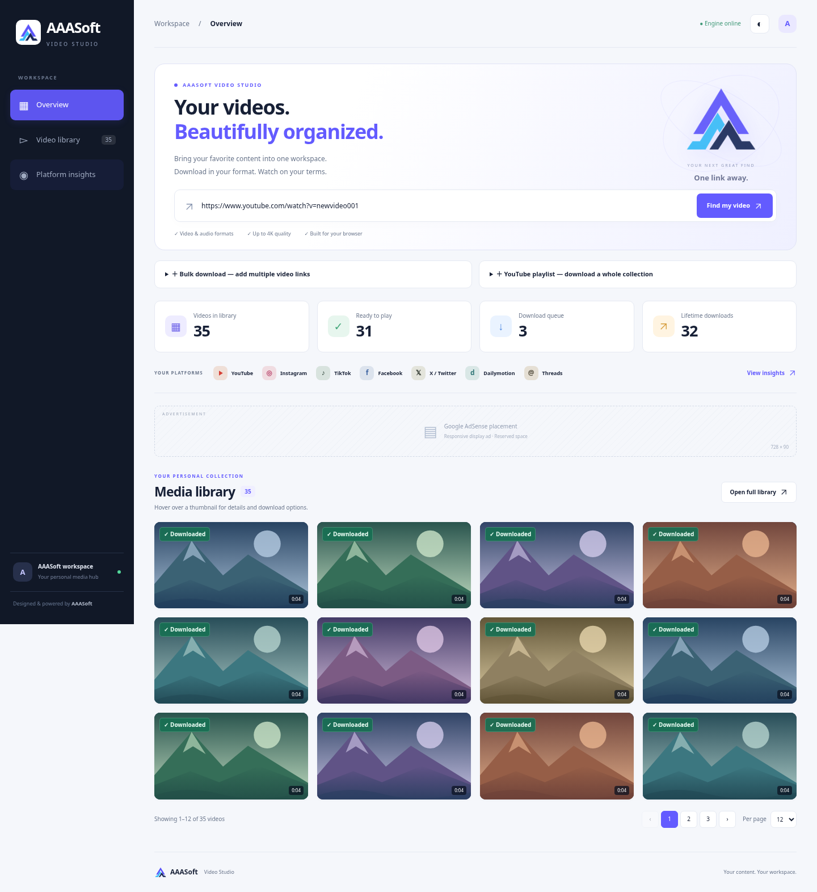
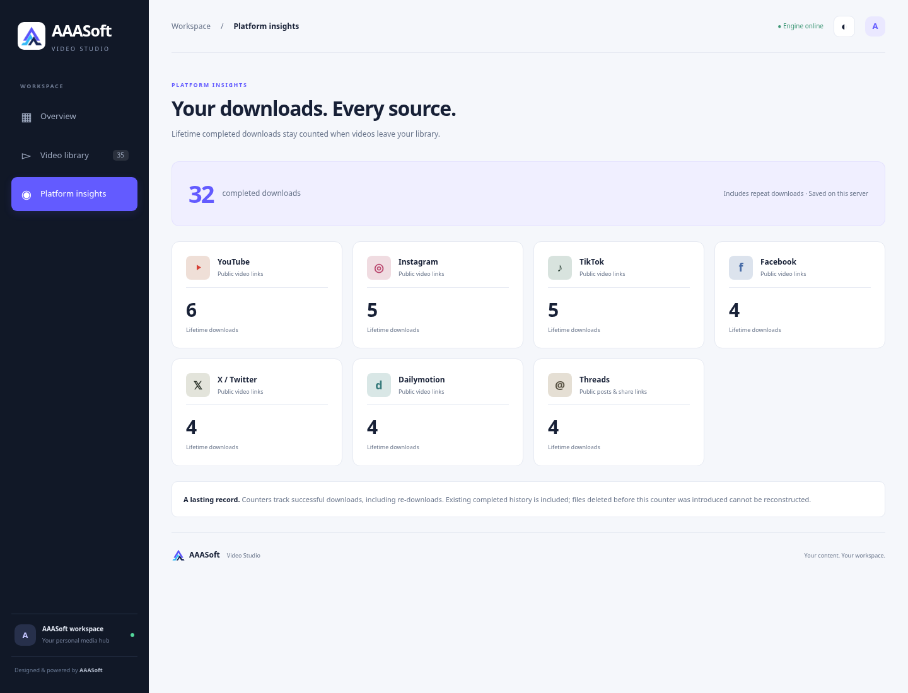

# AAASoft Video Studio 2.0.0

The portal now uses AAASoft branding, a generated transparent PNG logo, navy/indigo/sky-blue colours, Plus Jakarta Sans/Inter with system font fallbacks, and light/dark themes. Internal StreamVault health/authentication identifiers and the existing Windows launcher filename are retained for upgrade compatibility.

These screenshots use local demonstration media and SVG test thumbnails, not live platform downloads or production counters. External photography requests were blocked by the cloud proxy; no downloaded stock imagery is shipped in the app. The gallery uses users' source thumbnails, falling back to a locally generated poster when necessary.

## Gallery and navigation

Cards show only thumbnail, duration and downloaded/status badge until hover or keyboard focus. Details expose title, source, format, resolution, size, duration and status, with Play, Save, Again and Remove actions. Touch users have an explicit information control and expanded detail layout. Original playback and the separate compatible-preview worker remain available.

Overview and library paginate independently with 12/24/48 items per page, numbered navigation, previous/next, ellipses and range summaries. Search includes title, link and source family; search/status filters reset to page one. Polling retains page selection, clamps out-of-range pages, renders only current-page cards, and avoids replacing a focused card during same-status updates. Opening another navigation view returns to its top.

Again creates a fresh queued job using the original URL/format/quality without deleting its existing file. Previously downloaded normalized source links are also identified during fresh analysis. Source URL normalization covers common aliases/tracking forms, not arbitrary unresolved short-link redirects.

## Durable completion counters

`download_events` in the existing history database is independent of removable `jobs` rows. Each verified completion receives an attempt identity. Saving completion history and its event happens in one SQLite transaction; repeated preview/status saves use INSERT OR IGNORE and cannot add duplicate events. A fresh successful download/retry adds an event; failed/unfinished jobs and repeated browser saves of an existing file do not.

Startup backfills existing completed history once. Removing a video/history entry leaves its event and aggregate source counts intact. Already deleted entries predating this feature cannot be reconstructed. Counts cover the current server workspace, including audio extraction formats, and survive normal app restarts and updates when the full data directory is preserved. The ledger keeps platform, completion time and a hashed normalized video identity for previous-download recognition; removed job URLs/titles are not copied into event rows.

The new `/api/stats` and `/api/jobs/{id}/redownload` routes retain existing owner authentication and same-origin mutation protections. API docs use the AAASoft title.

## Advertising placeholders

Two responsive AdSense banner placeholders and a Google video-ad placement inside the player are clearly labelled reserved spaces. They do not load publisher scripts, IDs, Google IMA, VAST tags or live ads, and do not gate player/download actions. No AdSense or DoubleClick requests were observed in the browser test. Real ad account configuration is outside this placeholder implementation.

## Verification

- **162 backend tests pass locally and inside the fresh Docker image as its unprivileged user.** Existing real media transfer/conversion, streaming, queues, source throttling and playlist tests remain included. New tests cover legacy migration, deletion/restoration persistence, per-platform attribution, URL normalization, idempotent preview saves, separate successful attempts, exclusion of unfinished jobs, atomic rollback, fresh re-download jobs, previous-download detection and owner authentication. Logo delivery and completion counters are also checked through the real app/media pipeline.
- Chromium desktop checks exercised 35 fixture jobs across seven sources: thumbnail-only default state, hover and keyboard details, original AV1/Opus playback, page navigation and sizes, search/status filters, source-image fallback to a real generated poster, fresh download, count increase, deletion without count loss, prior-download analysis badge, platform totals and light/dark themes. Touch checks exercised details expansion and a 390px layout without horizontal overflow. There were no JavaScript errors.
- Browser checks used a local source adapter, real FastAPI/SQLite queues, FFprobe/FFmpeg, real generated media and browser streaming. They do not establish live source access, Google ad serving, or native Windows/Firefox/Safari behavior.
- JavaScript syntax and Git whitespace checks pass. Runtime dependencies and lockfiles are unchanged.

Keep `data/`, `.venv/` and `.env` when replacing project files, stop the old app before updating, then launch the existing Start StreamVault.bat and refresh with Ctrl+F5. Old running processes must be restarted to load the new APIs/migration.
