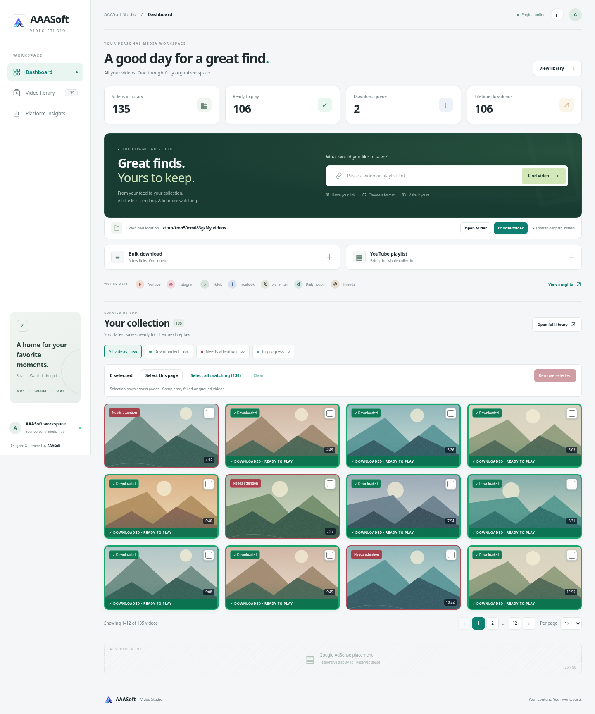

# Completion states, selection and source cooldowns — 2.3.0

Verified on 2026-10-22 in the cloud Linux workspace. Source requests in these checks use deterministic local adapters; no live YouTube download or native Windows GUI was tested.

The screenshot uses 135 seeded demonstration jobs, generated SVG landscape artwork and local H.264/AAC media. Counts and temporary paths are fixtures.

## Completion and selection

Completed cards use a green border, green downloaded badge and a persistent bottom completion strip. Failed cards retain red status even if the URL was downloaded in the past. The collection has four status filters with counts. Thumbnail checkboxes select individual removable jobs across pagination and polling. Select page/all matching, clear and Remove selected work in the collection and full library, with 12/24/48/100 page sizes. A confirmation explains external-original preservation and legacy project-file deletion.

The bulk API reuses the existing per-job guard and deletion rules. It accepts up to 1,100 IDs, deduplicates them and returns successful IDs plus per-entry failures. One unavailable/running job does not stop removal of the other selected jobs. Direct-save originals and permanent download counters are preserved. Project-owned media/cache is removed. Storage failures preserve the entry/file and return a safe error.

Queued work can be removed. Worker startup and removal share a per-job guard, so deletion cannot remove files under a running worker. Removed executor entries do not fetch. Deferred source work is discarded when its history is removed. Running transfers and active previews are protected and reported as per-entry conflicts.

## HTTP 429 behavior

YouTube can limit requests independently of the app. Existing work now enters a retained queued `source_wait` state with a retry timestamp instead of cascading into hundreds of failed jobs. One daemon dispatcher sleeps through the shared source cooldown and re-submits held work afterward; source access checks again at worker entry and at the transfer gate. There is no request loop during the wait and no increase to the one/two media-transfer limit. Further source 429 responses hold work again. A blocked new analysis/download/retry still returns Retry-After. Old failed jobs are not silently retried; interrupted work still requires explicit Retry on app restart.

## Verification

- **201 tests pass locally and inside the fresh Docker image**, as its unprivileged user with container networking disabled. One existing Starlette/httpx test-client deprecation warning remains.
- New tests cover mixed/duplicate/missing removal IDs, selected-folder preservation, permanent counters, legacy cleanup, active/preview conflicts, queued cancellation, worker/deletion races, history-write failure, request bounds, authentication/same-origin protection, deferred job persistence, source-free waiting, first-error queue retention, dispatcher deduplication/release/shutdown and other-platform availability.
- A Chromium browser integration starts with 135 mixed entries. It checks visible checkboxes, distinct completed/failed frames, status filters, selected IDs surviving polling and page changes, 100-entry selection/confirmation/cancellation/removal, originals/counters retained, running checkboxes disabled, queued removal and search-filtered full-library selection.
- The same browser test submits three actual worker jobs through the bulk API. A simulated terminal 429 causes exactly one source call and holds all three jobs. Expiring the local cooldown resumes them; all three complete into real selected-folder media, adding exactly three completion events. No extra request is made during the held interval.
- Responsive widths (1920/1440/1024/800/390), dark theme and JavaScript page errors are checked. JavaScript syntax and Git whitespace checks pass.

The native Windows picker, real source rate-limit duration, browser/account verification and live platform access are outside these fixture checks. The app cannot guarantee that YouTube will accept a request after the local cooldown ends.
