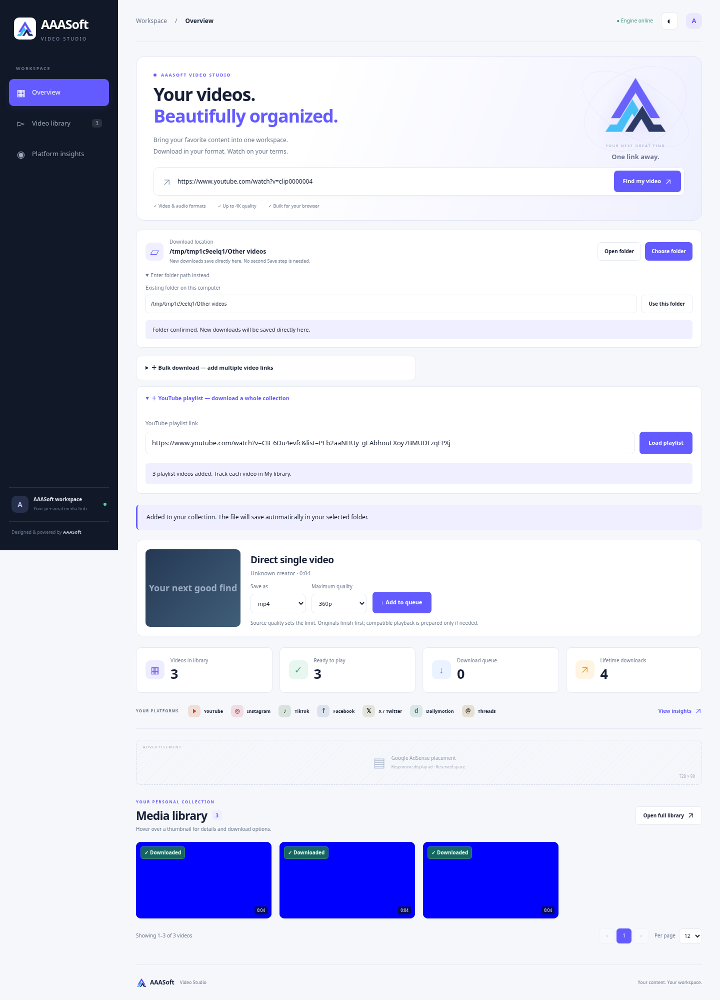

# Direct laptop saving and playlist loading — 2.1.0

Verified in the cloud Linux workspace on 2026-10-21. No live source videos were downloaded during these checks.

## Result

The local desktop launcher enables choosing an existing destination before creating single, bulk or playlist download jobs. Originals are downloaded/merged inside a temporary directory on the selected filesystem, then renamed into the selected folder. A second browser download is unnecessary. Completed cards open that original's folder and the player streams the saved original. An optional **Save a copy** remains in the player.

Playlist metadata uses a one-request gate separate from the one/two media-transfer slots. A load can list entries while both media slots are occupied. Metadata requests still serialize; source rate-limit cooldowns apply to both gates. Progress reports the actual phase and elapsed time. Missing playlist metadata thumbnails receive a YouTube poster URL fallback.

## Automated checks

- **186 tests passed** in the Python 3.12 workspace environment.
- **186 tests passed** inside the freshly built Docker image, as its unprivileged user and with container networking disabled. One existing Starlette/httpx deprecation warning appears in each run.
- Twelve real local-source download/conversion cases cover MP4, WebM, MKV, MP3, M4A and WAV in both legacy/server and direct-save modes, using FFmpeg/FFprobe, byte-range streaming and preview/poster routes.
- Folder confirmation, cancellation, unavailable dialog, one-dialog locking, invalid paths, public-mode denial, loopback/hostname checks and same-origin protection are covered. Client download payloads cannot select an arbitrary output directory.
- A same-filesystem publication test rejects any copy operation, checks inode preservation and verifies an existing user file is not overwritten.
- Published-original recovery and legacy merged-file recovery finish without another source request. Removing direct-save history preserves the original and lifetime counter.
- A playlist load completes while both media-transfer slots are deliberately held. Metadata gate serialization, cancellation and shared cooldown behavior remain covered.
- JavaScript syntax and Git whitespace checks pass. Both Compose templates validate with dummy deployment settings.

## Real browser integration

Headless Chromium used the actual API, SQLite, worker queues, FFmpeg/FFprobe and a four-second local H.264/AAC fixture. Only external extraction responses and the native picker/file-manager integrations were replaced by deterministic test adapters.

The browser loaded a three-entry playlist with both media slots held, prompted for a destination before queueing, then saved all three originals into that destination. No original MP4 appeared under project data and no browser download event fired. Temporary download directories were removed. Playback used the saved file, Folder invoked the recorded directory, and Save a copy remained optional. A simulated unavailable native dialog exposed the manual path field; typed input survived polling. Changing the folder affected only new jobs. Removing a library entry retained its selected-folder original and lifetime count. No JavaScript page errors occurred.

The blue thumbnails are generated test media, not live YouTube footage. Temporary Linux paths in this screenshot are test destinations.

## Practical limits

- The actual Windows native folder dialog and Explorer window were not exercised in this Linux environment. Their integration calls were mocked; entering an existing absolute folder path is the fallback.
- Existing completed files are not automatically relocated. Existing queued jobs keep the destination captured when they were created; old queued jobs without a destination retain legacy storage.
- New temporary media components live inside the chosen folder; metadata, posters and optional compatible previews still use project data. Optional preview encoding can create an additional derived file.
- Direct saving is for the same computer running the local launcher. Docker/public hosting continues to use server storage plus browser Save to device.
- These changes do not remove source authentication, availability, DRM or HTTP 429 restrictions, and do not establish live download performance on the user's network.
