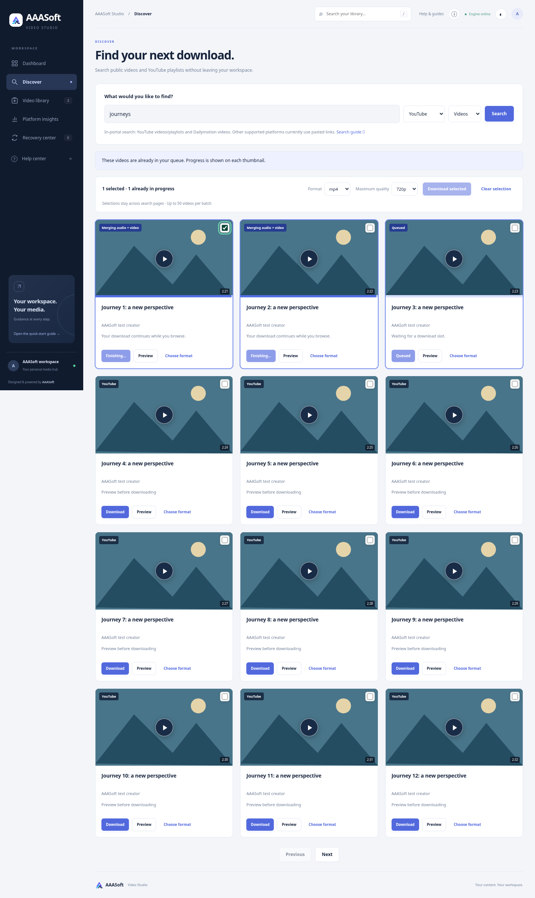
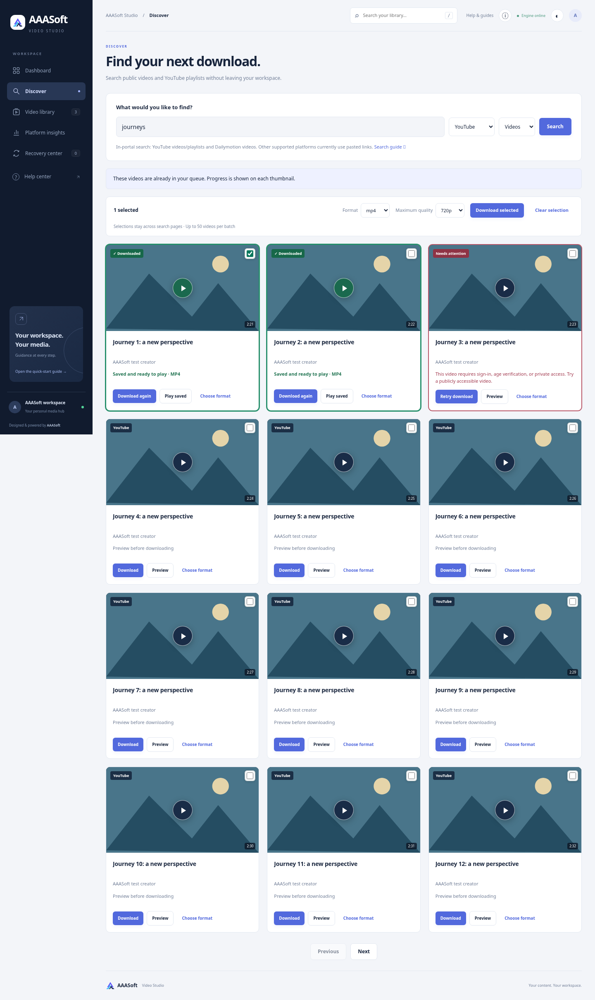

# Discover live progress and playback — 3.2.0

## Problem and resulting behavior

Search cards previously showed only lifetime history captured when the search ran. Clicking Download added a real job, but the visible card had no connection to polling updates. Users could not distinguish queued, running and completed work or play from Discover.

Search results and the job-list API now expose the same canonical source key. The existing two-second job poll patches visible discovery cards in place: queue/cooldown/recovery waits, numeric transfer progress, merging/conversion/verification, completion and source errors. In-place updates preserve selection and keyboard focus. Paging and new searches reconcile against current jobs. Returned queue jobs update cards immediately before the next poll.

Active downloads have blue frames, status badges and a thumbnail progress bar. Completed files have green frames/badges and Play saved. Errors have red frames and an explanatory message/tooltip. Download controls disable while adding or running; bulk submission filters active duplicates as well. Completed files can be downloaded again. Lifetime-only history remains Downloaded before rather than claiming a removed library entry can play locally. A previous completed copy stays playable during a newer running or failed attempt.

Preview and the thumbnail play control open an official YouTube privacy-enhanced/Dailymotion embed in a portal dialog when no saved file exists. Providers and IDs are validated before constructing a fixed embed URL. Frames load only after a click, use an origin-only cross-origin referrer policy, and unload on close/Escape. The dialog continues to show download state and offers Play saved when the download finishes. Saved media uses the existing portal player and compatible-preview fallback.

Source embedding, source/account/region restrictions and browser autoplay policies remain applicable. A provider error can appear inside its player; the surrounding note explains the saved-file alternative. This feature does not promise that every remote video can be embedded. Search does not automatically fetch media bytes or queue a download.

## Verification

- Local Python suite: **254 passed**, with the existing Starlette/httpx deprecation warning.
- Docker build and unprivileged, network-disabled container Python suite: **254 passed**.
- Optional reusable Chromium regression: `tests/browser_discovery.py`. It starts an isolated real FastAPI/SQLite service, generates a four-second H.264/AAC fixture with FFmpeg, simulates bounded source extraction/progress, and exercises actual queueing, saving and local playback.
- Browser coverage: no player loads or queue entries on search; explicit embed preview and referrer policy; teardown on close/Escape; three individual downloads; 37% live transfer; queued and merging states; disabled controls and duplicate submission protection; green completion and red private-source failure; saved-file playback; completion inside an open preview; cross-page and fresh-search reconciliation; focus preservation across progress updates; previous saved copy remains playable during a repeated transfer/failure; deleted-entry history; invalid provider/ID rejection; Dailymotion embed URL; 390px overflow check. No JavaScript errors.
- Python regressions verify short/tracked YouTube URLs share source identity with search results and cached results retain canonical identity.
- Browser source embeds and search metadata were intercepted with synthetic fixtures. These checks **do not verify live embedded YouTube/Dailymotion playback or live platform downloads**. Earlier live Dailymotion search was verified in 3.1; the user independently confirmed YouTube search. No new live-source claim is made for this release.

Run the browser regression with Playwright installed separately:

```sh
AAASOFT_TEST_PYTHON="$PWD/.venv/bin/python" CHROMIUM_EXECUTABLE=/usr/bin/chromium python tests/browser_discovery.py
```

The command's Python must have Playwright installed. Omit CHROMIUM_EXECUTABLE to use Playwright's managed Chromium. No production dependency was added.

## Screenshots

These show synthetic result metadata and local fixture media, not live platform downloads.




