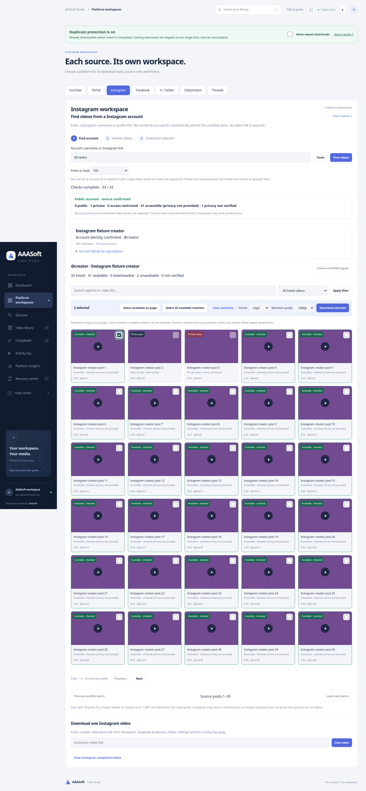

# Instagram account workspace — 3.8.0

## Scope and behavior

- Instagram now has its own account importer beside the existing single-video form. Input accepts a username or exact HTTPS Instagram profile URL; a helper video link is unnecessary.
- The custom reader uses Instagram web-profile and feed responses in one TLS-verified browser session. It avoids yt-dlp’s deprecated/broken InstagramUser extractor. Identity must match the requested username before any feed is read. Pagination uses feed cursors only, rejects missing/repeated cursors, and remains bounded and cancellable.
- Source-confirmed public/private account status is distinct from each post’s checked accessibility. Source blocks and login requirements remain unknown privacy. Private accounts are not enumerated.
- Single-video posts and reels can be checked, filtered, selected across pages, queued and saved through the existing download pipeline. Photo/carousel posts are listed but disabled, including during forced rechecks. This version does not extract carousel videos.
- Independent TikTok/Instagram workers, preview tokens and browser state; expiring previews, cancellation, rate-limit cooldown, idempotent queue submissions, active/history duplicate guards, progress, completed archive, permanent counters and activity log.
- Instagram /p/, /reel/ and /tv/ links share one video identity, including legacy history hashes. Deleted library entries retain completion protection.
- Optional AAASOFT_INSTAGRAM_COOKIE_FILE is local-only, disabled by default, separate from YouTube and rejected in public-server mode. No upload endpoint or credentials in API responses. The cookie jar may be updated by yt-dlp. TLS verification stays enabled.
- Separate English guide at /help/instagram-accounts, printable/downloadable from the portal. Compact typography and existing 5–6-column desktop card layout remain.

## YouTube and TikTok review

Existing automated API and Chromium flows were rerun after sharing the account workspace renderer and server routes. YouTube analysis also now accepts null format metadata without raising a server error. Existing source authentication, rate limits, deleted/private posts and format availability remain external constraints, not promises of universal success.

## Verification

- Full Python regression: 383 tests passed (one existing Starlette/httpx deprecation warning).
- Extended Chromium regression passed: all existing YouTube discovery/playlist/history/playback and TikTok account flows, plus Instagram identity/privacy, photo/private exclusion, independent state, pagination, selection across pages, official embed preview, two actual local fixture saves, completion badges/history, exact platform filtering and 390px layout; no JavaScript errors.
- Source-adapter tests cover account mismatch, private account, login response, feed pagination and repeated cursors, verified browser transport/headers, selection restrictions and local-only session settings.
- `node --check` for modified JavaScript and `git diff --check` passed.
- Screenshot below uses synthetic source metadata, colored demonstration thumbnails and local generated video fixtures. It does **not** demonstrate live Instagram extraction.

## Live source result and remaining limits

A bounded unauthenticated request for instagram.com/instagram/ from this environment returned HTTP 401 at the web-profile endpoint. No further repeated requests were made. Live account enumeration and authenticated session downloads could not be verified here. The portal reports the authentication requirement and links to setup guidance; it does not claim success or infer private status from HTTP 401.

Only source-returned entries can be shown; every historical post, private/deleted/restricted media, carousel extraction and universal download access are not guaranteed. Public websites can change endpoints or require login. Docker deployment was not rebuilt for this update; application and Chromium checks ran directly in the existing environment.
