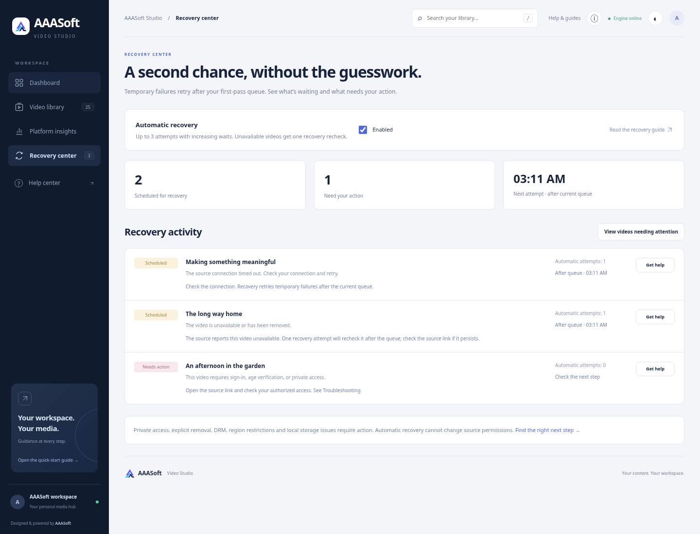
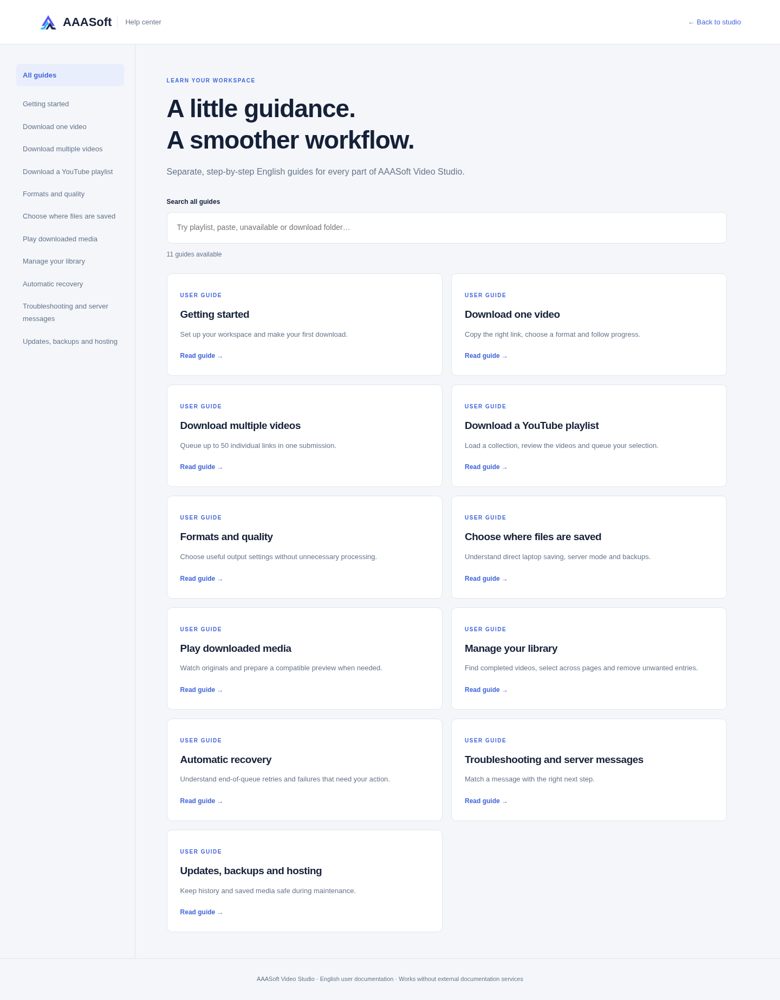

# AAASoft product workspace — 3.0.0

## What changed

The portal now provides a download workbench attached to the recorded destination, live activity panel, recovery navigation/view, System checks, clipboard Paste button, keyboard library search, library sorting, contextual help and a dismissible quick-start tip. Existing thumbnail completion colours, selection, pagination, file-safety confirmation and permanent counters remain available. Recovery activity renders fifty entries initially, with Show more controls for larger histories.

Screenshots use seeded demonstration history, generated SVG thumbnails, local H.264/AAC clips and temporary Linux output paths. They do not show production counts or live platform downloads.

## Attached log diagnosis

The supplied log shows a successful merge of Episode 104, deletion of merged component streams and a normal “already is in target format mp4” message. Later requests repeatedly receive YouTube “Video unavailable” from a `visionos` client. There is no Python server crash in the supplied text. A generic client response alone does not prove deletion or establish the cause for every source video.

PyPI returned **2026.10.21** as the current stable yt-dlp release during this update. The previous pin was 2026.8.19. yt-dlp and its required certifi minimum were updated (certifi 2026.10.19); `pip check` reports no broken requirements. The existing yt-dlp-ejs 0.8.0 dependency satisfies this release. The Windows launcher now detects outdated extractor/helper/certificate versions in existing environments and installs the lockfile when required, while accepting an already newer extractor.

For a generic Video unavailable response, extraction can try one `web/web_safari` alternate-client configuration under the same source/metadata gate. It does not trigger for private, explicit removed/deleted, copyright/region/age/DRM/bot or rate-limit failures, and it is not used for playlist-page listing. Source cooldowns and transfer limits remain enabled.

One live metadata check of the supplied public YouTube ID `_r7Ho0BaPHY` was attempted from this cloud environment. The outbound proxy rejected its tunnel with HTTP 403; source availability was therefore **not verified**. Proxy rejection now has a distinct actionable message rather than being described as a source-video 403. No proxy bypass or live source download was performed.

## End-of-queue recovery

Temporary network failures and upstream server errors receive at most three automatic attempts with increasing delays; a generic unavailable response receives one recovery recheck. YouTube rate limits respect the global source cooldown. Jobs that have not contacted a source during a cooldown do not spend an automatic attempt. Scheduled recovery waits until other first-pass jobs are no longer queued/running; separate jobs retain their own due times and source waits.

Private/explicitly removed/restricted/local-storage errors remain actionable. Exhausted attempts explain manual next steps. Recovery settings and per-job attempts/due timestamps persist. Startup or enabling recovery reconsiders eligible old failures. Pausing a pending attempt releases its reserved budget; a restart does not consume an extra pending attempt. Completed files and historical completion counts are unaffected. Older desktop jobs without a recorded output folder wait for folder confirmation; recovery then adopts that confirmed folder and can retain legacy merged-file recovery. Removing queued work cancels it; existing job guards protect running media and previews.

## English help

Eleven separate articles cover Getting started, Download one video, Bulk downloads, YouTube playlists, Formats/quality, Download location, Playback, Library selection/deletion, Automatic recovery, Troubleshooting and Updates/backups/hosting. Every guide has a standalone app route, Markdown download and print/PDF layout. Index search checks full article content. Help routes/static files retain the existing owner-authentication middleware. The standard-library builder is committed as `scripts/build_help.py`.

## Verification

- **233 backend tests pass** locally and inside the fresh Docker image as its unprivileged user with container networking disabled. One existing Starlette/httpx deprecation warning remains.
- Tests cover transient/permanent failure classification, bounded retry budgets and restoration, first-pass queue ordering, pause/resume, future wait retention, pending budget preservation, per-source dispatch, one alternate-client attempt with options preserved, no restricted/rate-limited fallback, help routes/English/downloads/access control, version checks and the prior real six-format media/file-safety/selection/streaming suite.
- A real Chromium workflow checks clipboard paste, analysis and queueing, startup recovery, pause/resume without burning the pending one-attempt budget, three actual local-media recovery completions after first-pass release, a successful bounded client fallback, permanent private-access action state, saved-file playback, System checks, keyboard search, sorting, all eleven searchable guides, a real Markdown browser download, print command/print CSS, onboarding dismissal, dark theme and seven viewport widths without horizontal overflow. No JavaScript page errors occurred.
- Source responses, native folder picker/file-manager integrations and demonstration history are controlled adapters. Real FastAPI, SQLite, background dispatch, FFmpeg/FFprobe and saved-file browser playback are used. Native Windows, native Edge/Firefox/Safari and actual source access after the user's network restriction remain unverified here.
- JavaScript syntax, Git whitespace, dependency consistency, help generation and container build/startup/static asset checks pass. Public hosting and real ad serving were not deployed or enabled.
