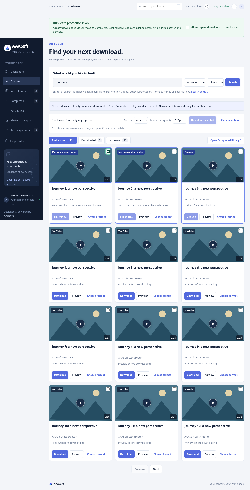
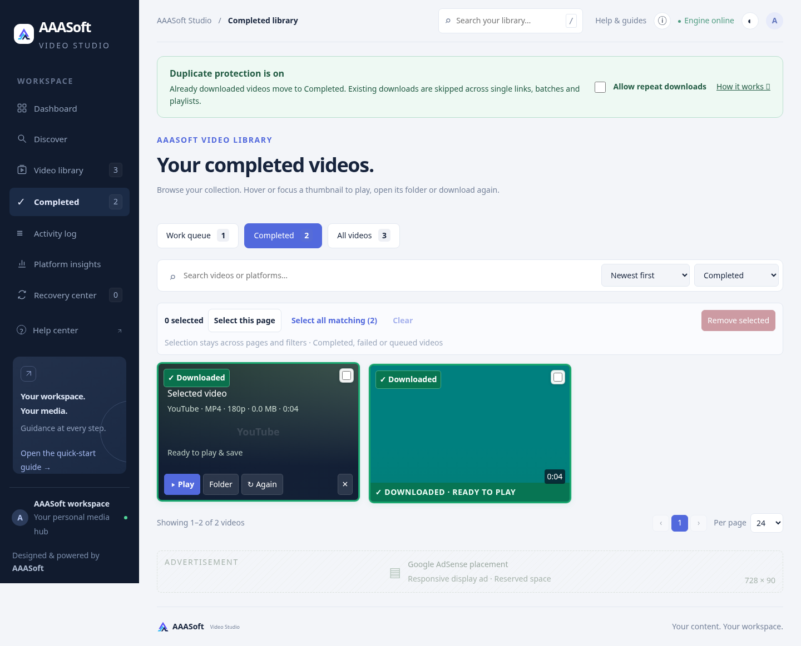
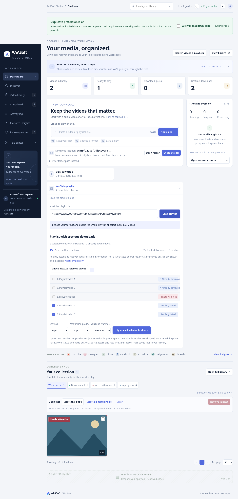
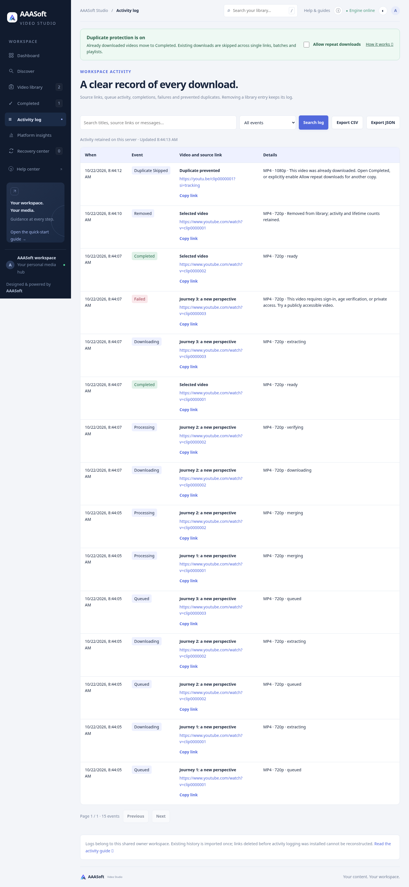

# Protected AAASoft workspace — 3.3.0

## Delivered behavior

- Default duplicate protection at server submission boundaries for single, bulk and playlist workflows. Canonical source identity covers supported URL variants, not visual copies/reuploads or every unresolved share alias. Queue checks and publication share a lock, so concurrent requests cannot both add the same source. Existing active copies cannot be duplicated even with repeat permission.
- Successful sources remain protected by the lifetime ledger after library deletion/restart. An explicit per-session Allow repeat downloads option covers deliberate alternate formats/qualities/copies. Completed-card Again asks for confirmation. Failed retry cannot race an active copy. Legacy queued duplicates are suppressed before source extraction and logged; they remain reviewable in All videos/activity rather than the default Work queue.
- Completed destination in navigation and library tabs; finished work automatically leaves Work queue. Discover offers To download, Downloaded and All results tabs for the current source-search page, plus a link to the full Completed library. No original file is physically moved or copied by a tab change.
- Playlist rows show retained previous completion counts and active queue state, independently of public/private/removed/live availability. Completed/active entries are disabled and unchecked by default. Explicit repeat permission allows deliberate selection of completed entries; restricted source entries stay disabled. A stale preview is rechecked at queue submission.
- Retained SQLite activity log records queue/status transitions, completions, failures, skipped duplicates and removals with original source URLs. Search, event filtering, paginated UI, Copy link and full CSV/JSON exports. Queue-state/audit writes for batches share a transaction. Exports use bounded batches and a stable append-only ID cutoff, without a long-lived database read lock. CSV formulas are escaped and timestamps are UTC. UI times use the browser's locale/timezone.
- Existing metadata imports once. Older deleted links cannot be reconstructed from hash-only lifetime events. The log belongs to the existing shared owner workspace and inherits its authentication; individual hosted customer accounts/tenancy are not implemented by this change. Cookies, proxy credentials and arbitrary private job fields are not exported.
- Normal UI text raised to a 14px floor; 16px search/path inputs, 18px result titles, larger controls, readable tabs and clearer empty states. Mobile widths use a single result column to preserve readability. English Help center expanded to 13 guides.

## Verification

- Local Python suite: **268 passed**. Existing Starlette/httpx deprecation warning remains.
- Docker build and unprivileged network-disabled container tests: **268 passed**.
- Reusable Chromium browser regression `tests/browser_discovery.py`: real isolated FastAPI/SQLite/FFmpeg fixture saves and playback; completion automatically leaves the search/default queue; Completed and work tabs; repeat policy and confirmation cancellation; playlist history remains visible/disabled after library deletion; single-video duplicate control; activity links, retained removals and full export routes; readable font assertion; prior preview/progress/playback coverage; no JavaScript errors; 390px overflow check passes.
- Server regressions cover concurrent canonical requests, active/completed/batch skip reasons, remembered history after removal/restart, explicit repeat vs active suppression, stale playlist recheck, legacy duplicate-worker suppression, retry protection, one-time migration, status-event deduplication, transactional rollback on audit failure, authentication, CSV formula protection, credential exclusion, complete 602-event export beyond page limits and stable snapshot cutoff while new events append.
- Several old cooldown/background-preview test fixtures used the same placeholder URL for different logical videos. They now use distinct source URLs to preserve those tests' original intent under source deduplication; dedicated new tests assert duplicate suppression itself.

No new live platform-download success is claimed. Browser source metadata/embeds use synthetic fixtures and local four-second H.264/AAC media. Source restrictions, network limits and embedding policies still apply. This is an improved single-owner product workflow, not a claim of fully validated commercial SaaS operation.

## Screenshots

All screenshots show fixture data.

