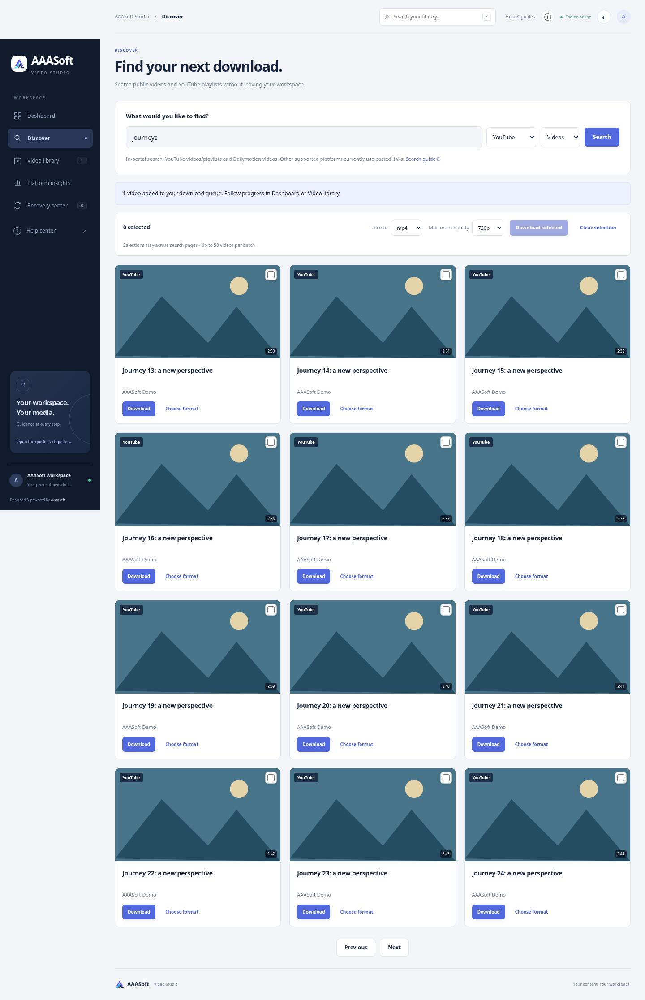
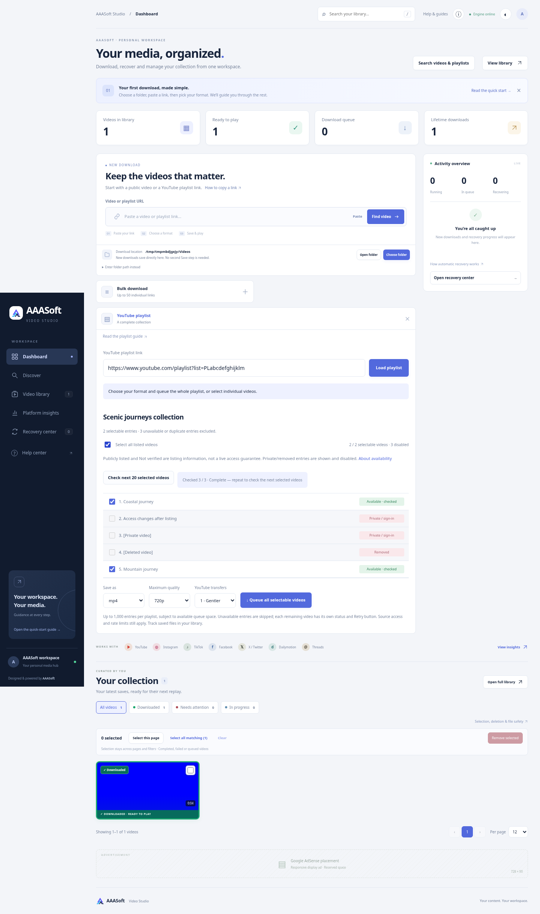

# In-portal discovery and playlist availability — 3.1.0

## Delivered

- Discover navigation and dashboard entry, source/type selectors, thumbnail/title/creator results, source paging (12 results/page, at most five pages), selection across pages (50 maximum), shared format/quality, download again and playlist review actions.
- YouTube video/playlist search uses yt-dlp's supported search-URL extractor through the existing metadata gate and shared source cooldown. Dailymotion video search uses its fixed public API endpoint. Search responses have a five-minute, 50-key cache and one active search per provider. Result links are rebuilt from validated source IDs, and remote thumbnails have HTTPS/provider-host checks.
- Other download-supported sources still accept pasted links; they are not presented as working search integrations.
- Playlist preview keeps returned unavailable entries visible with explicit statuses. Publicly listed is distinct from Not verified and Available · checked. Known private/removed/restricted/live/invalid/duplicate entries are disabled.
- Optional asynchronous checks inspect metadata sequentially, at most 20 selected videos per submission, through the shared metadata worker/gate. Repeat skips already attempted rows. Checks support cancellation, partial progress and source cooldowns without uncontrolled parallel requests.
- Newly private/removed/unavailable entries are deselected and rejected by the queue API. The preview cannot be queued while a check runs. Network failures retain unknown status; they do not fabricate removal. Source omissions remain unidentified.
- Separate English search guide, expanded playlist guide and 12-guide Help center.
- Fixed classification of the source wording “video is private,” including normal download error handling and recovery eligibility.

## Verification

- Python tests: **252 passed**. Existing Starlette/httpx deprecation warning remains.
- Docker image build and unprivileged network-disabled container tests: **252 passed**.
- Chromium browser integration: query/results, page changes, cross-page selection, selected queue, real local fixture saves into confirmed destination, playlist result review, private/removed disabled rows, live private exclusion, select-all, successful queue, canceled searches, English guide routing and no horizontal overflow at 390px. No JavaScript errors.
- Existing direct-save browser regression covers folder selection, bulk/playlist/single saving, no duplicate browser download, playback and destination validation.
- Live Dailymotion search for “nature documentary”: **12 results returned**. This verifies search metadata, not live media downloads.
- Live YouTube search was attempted once; the execution environment's outbound proxy rejects its tunnel with HTTP 403. Live YouTube search/download success is therefore **not verified here**. Fixture coverage verifies extractor parameters, filtering, gates and integration. Source restrictions and authentication remain applicable.

## Screenshots

The screenshots use synthetic search/playlist metadata and a four-second local H.264/AAC fixture. They are not evidence of successful live platform downloads.

