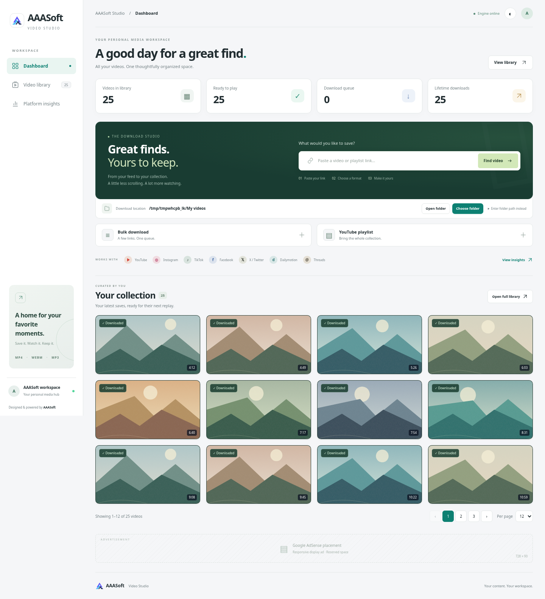
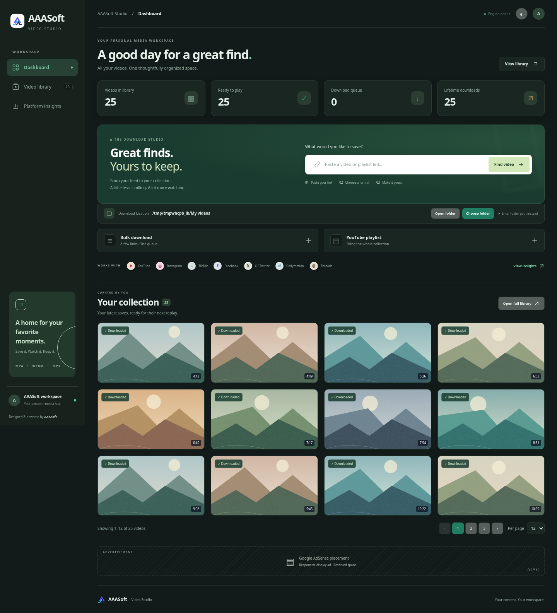

# AAASoft workspace redesign — 2.2.0

The portal layout was redesigned to put download tools and the media collection closer together. The former large logo banner and dark indigo sidebar are replaced by a white navigation rail, compact introduction, summary counters and an emerald/charcoal download composer. The destination is attached beneath the composer. Bulk and playlist forms are disclosed only when opened. The collection precedes the AdSense placeholder. The existing AAASoft mark is retained; navigation icons use SVG and typography uses Manrope/Inter with system fallbacks.

## Verification

- All **186 backend tests pass** in the Python 3.12 workspace; the existing Starlette/httpx deprecation warning remains.
- Headless Chromium checks cover the populated dashboard, thumbnail-only cards, visible hover actions within card boundaries, original saved-file playback and player cleanup, numbered pagination/page size, full library navigation, search and status filters, lifetime platform totals, light/dark themes and bulk/playlist disclosure.
- Layouts at 1920, 1440, 1280, 1024, 800, 700 and 390 pixels have no horizontal document overflow. At 1440 pixels the first collection row starts within the first 850 vertical pixels with forms collapsed. Hover controls remain available through keyboard focus; touch details retain their explicit toggle.
- A simulated old server without the destination API shows an amber restart status and visible instructions in the destination panel, instead of an indefinite checking label.
- The separate real browser download regression checks cover destination confirmation before queueing, playlist metadata while two media transfers are active, selected-folder originals, playback, manual path fallback, changing destinations and removal without deleting saved originals or lifetime counts.
- The updated Docker image builds and starts as the unprivileged app user; health reports 2.2.0 and the new theme stylesheet is served successfully. JavaScript syntax and Git whitespace checks pass.

Browser screenshots use seeded demonstration history, generated SVG landscape thumbnails, temporary output folders and a four-second local H.264/AAC fixture. They are not evidence of live platform extraction, production counters or the user's Windows folders. Native folder picker/file-manager calls were replaced with test adapters. Native Windows, Firefox and Safari were not exercised in this cloud check. No real ads or advertising scripts were enabled.

Runtime dependencies, extraction settings, destination semantics and permanent counters are unchanged by this visual redesign. The main stylesheet keeps functional component styles; `app/static/studio.css` owns the new presentation and responsive theme. Browser assets and backend version are both 2.2.0 to detect stale running servers.
