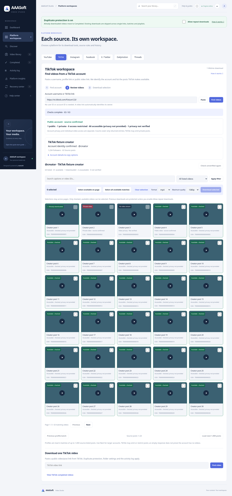

# TikTok privacy and access evidence — 3.6.1

## Reported problems

The supplied screenshots show failed account listing with a misleading temporary-block heading, and a video-assisted request that confirms the username but does not establish account privacy. A single-video metadata request also returned the generic Download failed message.

## Changes

Account privacy is a separate source-derived Public / Private / Not verified status. A confirmed username or a usable media listing does not establish whether the account is public. The explicit privateAccount flag is retained; an unambiguous account-private source error can establish private status when metadata is absent. Ambiguous likely/either-private errors, sign-in requirements, HTTP 403/429 and failed account-ID resolution do not prove private status.

Each returned entry carries separate video visibility and availability: Public video, Private video, Access restricted, Accessible (privacy not provided), or Not verified. Public/private requires explicit source metadata or a specific private-video error. A sign-in prompt is restricted access with unknown privacy. Playable media without a privacy flag is accessible at check time, not labelled public. Selection still requires usable video metadata; private/restricted entries remain disabled.

Added public/private/restricted filters and returned-entry counts. Counts cover only source-returned entries; hidden/omitted private posts cannot be counted. Supplied-video access can remain visible even when full account listing fails. Single-video analysis exposes the same labels and disables queueing known private/restricted or unverified media. Explicit private responses, access-required replies and generic metadata failures now have different messages.

Fixed the recovery heading's loose regular expression: the substring rate matched separately. Account failures now use server issue codes; the fallback checks explicit HTTP/IP phrases. Failed account resolution/verification does not assert a confirmed rate/IP block. Changed Public account identity confirmed to Account identity confirmed so an identity match cannot be mistaken for a privacy determination.

## Verification

- Python tests: **342 passed**, one existing Starlette/httpx deprecation warning.
- Chromium regression passed public-account metadata display, private/public video filters and disabled private selection. The unknown account lookup fixture specifically checks that the misleading blocked heading does not appear, even though the explanatory message contains separately. Existing paging/selection/history/local fixture downloads, playback, clipboard and responsive checks pass with no JavaScript errors.
- Docker image built successfully. Initial container startup hit the cloud Docker filesystem limit; obsolete project images and regenerable build cache were removed. The network-disabled non-root test run used a 2 GiB temporary filesystem and passed **342 tests** (one existing deprecation warning).
- JavaScript syntax and whitespace checks passed; screenshot visually reviewed.

Tests include known public/private/unknown account flags, explicit versus ambiguous private errors, login/403/lookup failures, playable media without privacy flags, private/restricted video disablement, filters/counts, and single-video response messages.

No new live source probes were made after earlier cloud TikTok blocking. This release does not establish whether the account in the screenshot is public/private, or that its list/videos will download. A source/network failure must remain Not verified when no reliable privacy signal is available.

## Preview

Fixture data, not evidence of the supplied live account.

## Update

Preserve data/, .env, .venv and media folders while updating code. Restart the app and use Ctrl+F5 to load version 3.6.1. The English TikTok guide explains privacy evidence and the returned-entry count limits.
