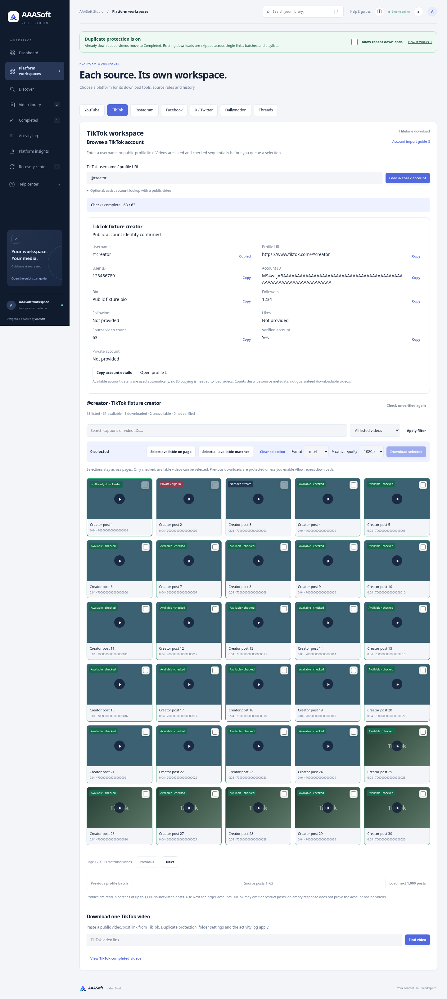

# TikTok public account details — 3.5.0

## Behavior

Enter a username/profile and choose **Load & check account**. A compact account panel displays source-provided public name, username, profile URL, bio, user/account IDs, avatar, follower/following/like/video counters and verification/private flags. Copy buttons support individual values and a plain-text account summary. IDs are used by the account loader automatically; manually copying IDs is unnecessary. The existing availability/selection/paging/download workflow continues below the details panel.

Before TikTok supplies metadata, the requested username/link are clearly labelled unconfirmed and other fields say Not provided. Source counters are not invented from the returned batch or treated as a guarantee of downloadable posts. Public metadata already received remains visible if later account listing fails. An input change clears stale profile details. Source-supplied text uses textContent; avatar URLs use the existing CDN allowlist. The panel adapts to narrow screens and retains compact typography.

Fixed the reported assisted-lookup failure: yt-dlp normally supplies a numeric **uploader_id**, whereas the username is in **uploader_url**. The helper now validates the source profile URL and matches its username case-insensitively. Legacy textual uploader IDs remain supported; a numeric ID alone cannot verify a username. A mismatching author is rejected with the actual username when known. Existing direct/short-link validation and duplicate protection remain in place.

The registered TikTokProfileIE extends the pinned upstream TikTok account extractor and captures public userInfo from the same universal page data already read during normal listing. It makes no extra profile request. No private endpoint, credential collection or access-control bypass was added. The username workflow remains subject to TikTok's account API and network restrictions. Details will be incomplete if the source does not expose them.

## Verification

- Python regression: **322 passed**, one existing Starlette/httpx deprecation warning.
- Final Docker build: passed; **322 tests passed** in an unprivileged network-disabled container.
- Chromium browser regression: passed. Added source profile metadata display and actual clipboard Copy Username verification alongside existing account paging/selection/preview, two local fixture saves, duplicate/history, exact source filter and responsive checks. No JavaScript errors.
- Extractor test exercises actual universal JSON parsing from an in-memory profile webpage and proves only one page request is used.
- Tests verify realistic numeric user ID plus profile URL, public counters, profile retention after listing failure, missing values, unsafe avatar rejection and mismatched identity protection.
- JavaScript syntax and git whitespace checks passed.

Browser/profile fixtures are controlled local metadata, not proof of live TikTok downloads. The earlier live cloud probes were blocked and were not repeated during this update. Live availability of the supplied account/video remains unverified. Private, removed, hidden, regional or IP-blocked posts are not guaranteed to list/download.

## Preview

This screenshot uses fixture metadata and thumbnails.

## Update

Stop the running app. Preserve data/, .env, .venv and all media folders while replacing project code. Restart and refresh with Ctrl+F5 to load version 3.5.0. The English TikTok account guide describes the new panel.
