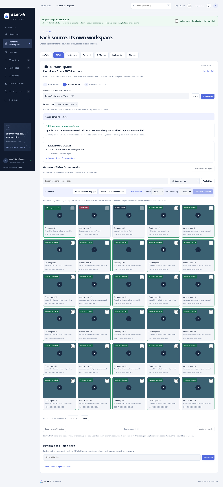

# Streaming account listing progress and review windows — 3.6.4

## Observed behavior

The user's attached Windows log initially fails username-only secondary-ID lookup, then succeeds when given @bilalchhachhi/video/7677853430634876181. The browser-compatible API transport paginates through at least page 32 / item 465 and begins page 33. There is no JSON error in that video-assisted attempt. The screenshot's zero count is therefore not evidence of a failed list request.

The app waited inside processed extract_info before receiving the list. Even with lazy_playlist, yt-dlp's playlist processing can enumerate many entries before returning control. The application's per-entry progress loop had not begun, so the portal remained at zero while console item numbers increased.

## Changes

The account list uses extract_info(..., process=False); the app consumes its raw iterator inside the same open shared downloader/session. Found/scanned counts update on each entry. A threaded regression proves the first entry is observable while the source generator is still blocked before its second entry. The source offset and limit are applied manually exactly once; one sentinel entry establishes has_more. Exceptions still reject incomplete imports.

The browser defaults to 30 posts for faster review, with 100/250/1,000 choices. Next/Previous use the actual preview window size. The existing API keeps its previous 1,000 default for compatibility and validates explicit sizes within 1–1,000. The listing bar is indeterminate while its total is unknown. Larger windows still require more sequential availability checks; this does not create unrestricted parallel source requests.

Source listing and per-video checking remain separate. Full media download happens only after checked videos are selected/queued. The console's Downloading item N during metadata enumeration is not a completed media-save count. Username-only lookup remains source-dependent; a successful video-assisted import does not establish that the profile endpoint is repaired.

## Verification

- **353 Python tests passed**, one existing Starlette/httpx deprecation warning.
- Added threaded streaming-progress, bounded iterator/sentinel, offset-once and size-validation tests. Existing large-window test now models the unprocessed full source stream correctly.
- Chromium regression passed a 30-post first window, next window (posts 31–60), previous window, and larger 1,000 window with the existing privacy/history/selection/paging/fixture-download/playback checks. No JavaScript errors; compact typography and five/six-column layout remain verified.
- A bounded live raw-extraction check of the supplied Bilal post confirmed its owner and returned **31 unique entries** (30 plus a sentinel) through the browser-compatible account API. No full video was downloaded. The managed cloud trust option remained enabled with TLS verification.
- JavaScript syntax and git whitespace checks passed. The preview was visually reviewed.
- Docker verification was not repeated after the previously documented cloud storage limit; local tests/browser/live evidence are recorded above.

The Windows log proves successful pagination at that time, not a finished import or every historical post. Source omissions/private posts, later request failures and access changes remain possible. Counts cover source-returned entries only.

## Preview and update

Screenshot uses fixture metadata with the larger test window selected; the browser default is 30. Preserve data/, .env, .venv and media folders when updating, restart and refresh with Ctrl+F5. Existing in-progress work may be allowed to finish before updating.
