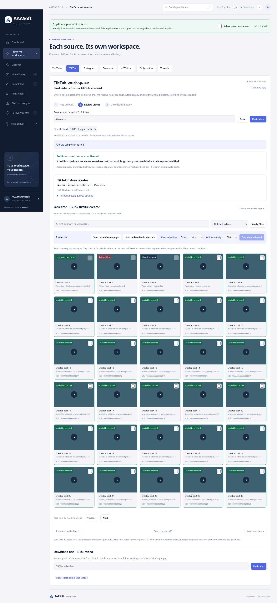

# TikTok username/profile-first extraction — 3.7.0

## Root cause

The user correctly rejected requiring an existing video URL to list an account. A direct read of the supplied gamingpclahore profile returned a 1,462-byte page with TikTok's native challenge marker, not public profile metadata. The upstream video path invokes its native challenge handler, while the upstream username path previously parsed that challenge page as a profile, failed secondary-ID resolution and fell back to an embed.

## Changes

The registered profile adapter detects the identified native challenge on a username/profile response, invokes the existing yt-dlp maintained handler, and reads the same public profile once more in the same session. It does not repeatedly loop. Temporary cookies from this exchange are cleared in a finally block. The code does not change a login/private response into a public account or disable source/TLS checks.

Matching legacy SIGI_STATE public profile metadata is supported when the page uses that format instead of universal data. Universal responses for another username are rejected. A source-verified numeric user ID can map to the canonical username only when its returned user ID matches exactly. The account task and review URLs then use that canonical username automatically.

The primary UI/help now says username/profile lookup needs no video link. The retry action is Try another username rather than instructing users to find a post first. Optional direct/share-video inputs still work. Streaming progress, small review windows, explicit privacy status, duplicate/history protection and download selection remain intact.

## Verification

- **359 Python tests passed**, one existing Starlette/httpx deprecation warning.
- Native-challenge tests exercise the actual upstream handler against a synthetic bounded fixture, assert a two-profile-request flow with no video/embed request, and verify temporary-cookie cleanup.
- Repeated challenge response is bounded to one retry. A private profile after a challenge is not enumerated; a wrong profile is rejected. Legacy public profile data resolves without another request. Numeric source-ID matching/canonical review links are covered.
- Chromium regression passed the username-only primary flow, privacy/filtering/copy, 30-post window, next/previous windows, larger window, selection/history, two local fixture saves and saved playback. No JavaScript errors or responsive overflow.
- A bounded live **username/profile-only** lookup of gamingpclahore confirmed the source identity and retrieved **16 unique account entries** without any seed video URL. This is real metadata retrieval, not a complete historical inventory or sixteen video downloads. The existing cloud system trust option was used; TLS verification remained enabled.
- Syntax and git whitespace checks passed. Docker verification was not repeated after the earlier cloud Docker storage constraint; no current Docker result is claimed.

The live result establishes username-only resolution for this supplied profile at check time. It is not a guarantee of access to private/removed/omitted posts, every profile, or every network. The user's laptop must still retest this request path. Numeric-ID behavior was fixture-tested, not separately live-tested.

## Preview and update

The screenshot uses fixture metadata. Preserve data/, .env, .venv and media folders when updating; restart the server and refresh with Ctrl+F5. Enter @gamingpclahore or its profile URL under TikTok → Find videos. No manual user/account ID or existing post link is required for this primary workflow.
