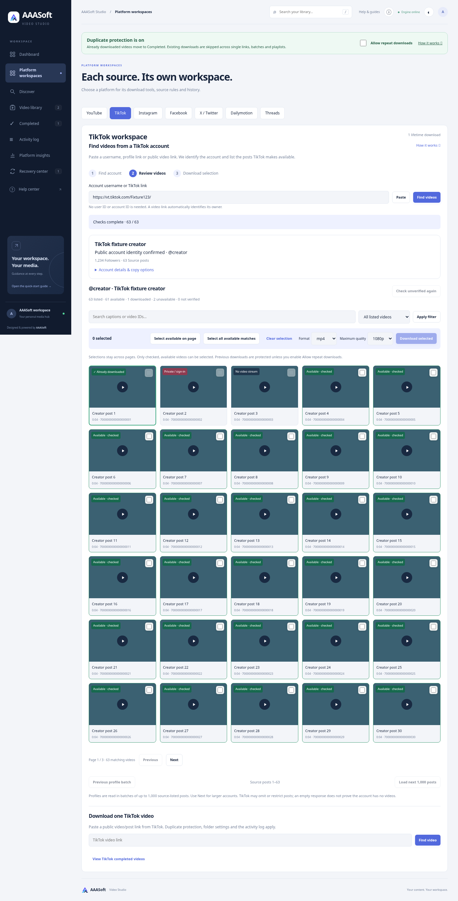

# Rebuilt TikTok account workbench — 3.6.0

## Problem and behavior

The reported screenshot showed a failed source listing followed by a large grid of Not provided values. The grid merely repeated the requested username and implied a successful lookup. A separate optional public-video field also required users to understand an internal account-resolution fallback.

The workbench now has one input and three visible steps: **Find account → Review videos → Download selection**. It accepts @username, a public profile URL, a direct TikTok video URL or supported vt/vm/t share URL. A video-only request resolves its actual source-provided username and account ID automatically before account listing. Numeric IDs alone never establish a username. The old optional helper field is removed from the UI; legacy clients can still send its existing API field.

An unconfirmed identity no longer produces a profile panel. A confirmed identity gets a compact summary, with Account details & copy options collapsed by default. Missing fields are omitted instead of filling a grid. Existing public details remain available when a later listing request fails.

Source errors display next steps: try a real public video link in the same input, open the validated supplied TikTok link in the browser, or focus the single-video downloader. A supplied video/share URL is carried into that form without starting a download and clears stale analysis. Rate/IP failures explicitly advise waiting; repeated requests do not remove a source block. Failed listing and empty listing do not imply that an account has no posts. The account field has a clipboard Paste action with manual-paste guidance if permission is unavailable.

Existing checks, filters, cross-page selection, source batches, duplicate/history protection, progress, format/quality, destination, source previews and saved playback remain. Compact fonts and five/six desktop thumbnail columns are preserved. The English guide now matches the single-input workflow.

## Verification

- Python suite: **326 passed**, one existing Starlette/httpx deprecation warning.
- Docker image build succeeded. **326 tests passed** as the image's non-root user with networking disabled; temporary test files used a 2 GiB tmpfs because the Docker backing filesystem was full. Application free-space protection stayed enabled.
- Chromium workflow passed: simulated username-resolution failure hides the profile grid and exposes recovery; the recovery action clears/focuses the same input; a video-only share link then resolves its source account; metadata, collapsed details/copy, availability, selection/pagination, two real local fixture saves and saved playback pass. Existing Discover/archive/activity/duplicate regressions pass; no JavaScript errors. Narrow layouts have no horizontal overflow.
- Added backend cases for direct and short video-only inputs, numeric-only identity rejection, canonical account preview identity and ambiguous two-video rejection. Foreign/unsafe URLs and same-account checks remain covered.
- JavaScript syntax and git whitespace checks passed. Preview was visually reviewed.

Fixtures model source responses and use local media; they do not establish live success for the account in the screenshot. Earlier cloud TikTok access was blocked; this release did not repeat those blocked live probes. This rebuild changes application behavior and guidance, not TikTok's public account API, verification, IP or private-access rules. Account listing can still be blocked while individual videos work. Universal access to every post is not promised.

## Preview and update

The screenshot uses fixture metadata. Stop the running server, preserve data/, .env, .venv and media folders when updating, restart, and refresh with Ctrl+F5. Use **Platform workspaces → TikTok → Find videos**.
