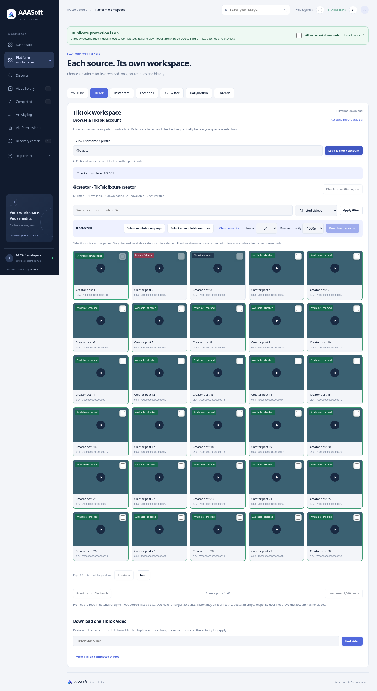

# TikTok account importer and platform workspaces — 3.4.0

## Delivered workflow

Platform workspaces provides seven independent source panels: YouTube, TikTok, Instagram, Facebook, X / Twitter, Dailymotion and Threads. Each validates its own single-video URLs, shows the retained source counter and opens an exact platform-filtered completed library. Existing YouTube/Dailymotion search and YouTube playlist tools are linked from their panels. Other sources do not claim account-import or universal-search support.

TikTok accepts a public username/profile, loads source-returned posts in windows of 1,000 and sequentially checks usable video metadata. Available entries are selectable; private/removed/restricted/audio-only entries are disabled. Untested entries remain Not verified after network failures. The optional same-account public video resolves a validated source channel ID if ordinary profile resolution fails. No passwords/cookies are collected by this workflow.

The review supports caption/ID search, status/history filters, pagination, cross-page selection, select page/all matching available, stop/recheck, next/previous source windows, official source previews, saved playback and live download badges. Account previews hide the generic modal Download action so selection uses checked entries. Duplicate protection and existing destination/format/quality settings apply. Distinct subsequent selections are allowed; request IDs make submission retries idempotent. Previously downloaded/active posts are disabled by default. Explicit repeat permission allows a deliberate completed repeat.

Tasks and previews are bounded, cancellation-aware and expire after 30 minutes following checks. One listing/check task runs at a time. HTTP 429 or explicit TikTok IP blocks pause account requests for ten minutes. A blocked check stops rather than misclassifying remaining posts. TikTok rate limits do not trigger the YouTube cooldown. Source IDs and URLs are validated; output uses existing authenticated endpoints and shared owner workspace. This is not a multi-tenant account system.

TikTok identity uses its numeric post ID across renamed/case-varied usernames. Legacy URL-hash ledger records are recognized for known original URLs, and retained completion URLs permit identity repair. Already-deleted historical URL aliases cannot be reconstructed from a hash alone. Lifetime events/counters are preserved.

Compact typography is unchanged. Account cards use five desktop/six wide columns and adapt down to two on narrow screens. A separate English account guide joins the existing thirteen guides.

## Verification

- Python regression suite: **306 passed**, one existing Starlette/httpx deprecation warning.
- Chromium browser regression: passed account metadata checks, private/audio disablement, history exclusion, paging/cross-page/all-match selection, account preview, two selected fixture downloads saved through the real local queue/FFmpeg flow, live progress, exact platform library filter, source-panel persistence and mobile overflow checks; no JavaScript errors. Existing Discover, playlist/history, archive, activity export, duplicate protection and saved playback checks also passed.
- JavaScript syntax and whitespace checks pass.
- Docker packaging: final image build succeeded; **306 tests passed** with networking disabled and a non-root user (one existing deprecation warning).

Browser fixtures use 63 simulated account entries and local four-second media. They verify application behavior, not live TikTok availability. Run `python -m pytest -q`; optional browser regression is `python tests/browser_discovery.py` with Playwright/Chromium installed. `AAASOFT_TEST_PYTHON` and `CHROMIUM_EXECUTABLE` select executables.

## Live checks and limits

One live public `@tiktok` profile metadata probe failed to resolve the secondary user ID. A public fixture post probe (`@denidil6/video/7065799023130643713`) encountered an explicit IP-address block, preventing fallback verification. No live TikTok media download or successful account enumeration is claimed. There were no repeated attempts after the block.

Source omissions cannot be individually identified. Available means usable metadata at check time, not a guarantee of a later successful transfer. Private accounts, removed posts, regional access, authentication, disabled embeds and source throttling remain source-controlled. Source-window pagination may shift if the account changes while browsing. Stop may wait for the current network request to finish. Preview state is temporary; queued jobs/history use the existing persistent storage.

## Preview

The screenshot contains fixture posts, not proof of live TikTok account access.
